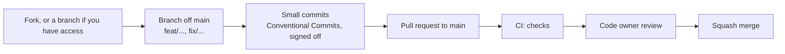

# Contributing to Pulse Mobile

Thanks for wanting to help. Pulse Mobile is an Android app that reads Fitbit data from Health Connect and keeps
everything on the phone. Contributions of every size are welcome: bug reports, docs, fixes, screens and better
algorithms.

## Before you start

- **Licence.** Pulse Mobile is source-available under [PolyForm Noncommercial 1.0.0](LICENSE), not an OSI
  open-source licence. By contributing, you agree that your contribution is licensed under the same terms, and that
  the maintainer may relicense the project in the future.
- **Talk first for big changes.** Open an issue before a large feature or a change to how a score is computed, so
  we agree on the approach before you write the code.
- **Security issues** go through [SECURITY.md](SECURITY.md), never a public issue.
- Be kind: see the [Code of Conduct](CODE_OF_CONDUCT.md).

## Set up

You need Node 24 and pnpm (the version pinned in `package.json`; `corepack enable` picks it up), and Android Studio
for a local development build. Health Connect is a native module, so Expo Go does not work.

```sh
pnpm install
pnpm android    # builds a development build and runs it on a phone or emulator
```

Or build one in the cloud with `npx eas-cli@latest build --profile development`, then `pnpm start` and open the project
in that build. On the phone, let the Google Health app share with Health Connect, open Pulse, tap **Connect Health
Connect** and allow every permission, including past data. Every command is in [AGENTS.md](AGENTS.md#commands).

## How changes land



1. Branch off `main`: `feat/short-name`, `fix/short-name`, `docs/short-name`.
2. Commit in small steps with [Conventional Commits](https://www.conventionalcommits.org/)
   (`feat(sleep): ...`, `fix(sync): ...`, `docs: ...`) and sign off each commit with `git commit -s`
   ([Developer Certificate of Origin](https://developercertificate.org/)).
3. Before you push, run `pnpm typecheck && pnpm lint && pnpm test`, and the bundle check from AGENTS.md when you
   change `babel.config.js`, `metro.config.js`, `app.json` or a dependency.
4. Try UI changes on an Android phone or emulator.
5. Open a pull request and fill in the template. CI must be green.

## The rules of the codebase

[AGENTS.md](AGENTS.md) is the guide for both people and coding agents. The short version:

- **Health Connect only, Android only.** No accounts, no server; the app never writes to Health Connect.
- **Honest states.** Every nullable metric is `{ value, reason, provisional }` with a reason code. Never show a
  made-up number.
- **Causality.** A day's scores depend only on that day and earlier days.
- **No native edits.** `android/` is generated; configure native behaviour in `app.json` and config plugins.
- **Tests beside the code.** Algorithms get golden-value or property tests; queries run on the in-memory store.

## Privacy and assets

- Use demo data in issues, screenshots and test fixtures. Never commit or post real health data or exports.
- Never commit third-party screenshots (from any other app). Describe them in words.
