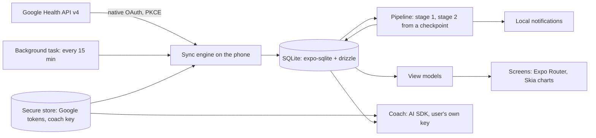

# Pulse Mobile

Pulse Mobile is the React Native app version of [Pulse](https://github.com/adityaongit/pulse): recovery, strain, sleep, Pulse Age, stress, Energy Bank and journal insights from your Fitbit Air data, on your phone.

There is no server. The app signs in to Google with a native OAuth client (PKCE, no client secret), pulls your data from the Google Health API itself, keeps it in SQLite on the phone and scores it with Pulse's own scoring code. Secrets stay in the phone's secure store, and nothing is sent anywhere except to Google and, if you set one up, your own AI provider for the coach.



Status: early scaffold. The plan is in [docs/plan.md](docs/plan.md).

## Setup

You need Node (current LTS) and [pnpm](https://pnpm.io).

```bash
pnpm install
```

## Run it on a phone

Expo changes every SDK, so check the current docs first: fetch https://docs.expo.dev/llms.txt and follow its links. This project is on SDK 57.

1. **Expo Go, for now.** `pnpm start` prints a QR code. Expo Go only works while the app uses native modules it bundles, and each Expo Go build supports one SDK.
   - Android: install the Expo Go build for SDK 57 from https://expo.dev/go.
   - iPhone: the App Store version of Expo Go stops at SDK 54. For SDK 57 use `eas go` to put Expo Go on your phone through TestFlight (needs an Apple Developer Program membership), or use a development build.
   - Details: https://docs.expo.dev/troubleshooting/expo-go-version-mismatch.md
2. **A development build, once native modules beyond Expo Go arrive.** `expo-dev-client` is already installed. Build one with `npx eas-cli@latest build --profile development` (no Xcode or Android Studio needed), or locally with `pnpm ios` or `pnpm android` (needs Xcode or Android Studio). Then `pnpm start` and open the project in that build. Docs: https://docs.expo.dev/develop/development-builds/introduction.md

Google sign-in needs OAuth clients tied to the app's bundle id and Android package `in.portlabs.pulse`: see [docs/google-console.md](docs/google-console.md).

## Commands

| Command | What it does |
|---|---|
| `pnpm start` | Dev server |
| `pnpm ios` | Build and run a development build on iOS |
| `pnpm android` | Build and run a development build on Android |
| `pnpm typecheck` | `tsc --noEmit` |
| `pnpm lint` | ESLint |
| `pnpm test` | Vitest in Node |
| `pnpm db:generate` | New drizzle migration from `src/data/schema.ts` |
| `npx expo install <pkg>` | Add a dependency (use this, not `pnpm add`) |
| `npx expo-doctor` | Check dependencies and config |

## Documentation

- [AGENTS.md](AGENTS.md): commands, layout and rules for contributors and coding agents.
- [docs/plan.md](docs/plan.md): the build plan.
- [docs/learning.md](docs/learning.md): a running notebook of the React Native and Expo choices made here, and why.
- [docs/design/spec.md](docs/design/spec.md): the UI contract.

## License

[PolyForm Noncommercial 1.0.0](LICENSE). Use it, change it and share it for any noncommercial purpose. Selling it, or putting it inside a commercial product, is not allowed.
