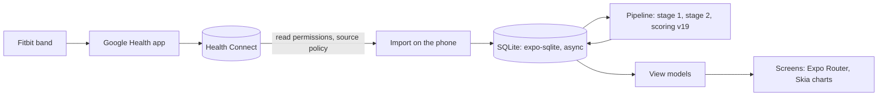

# Pulse Mobile

Pulse Mobile is the Android app version of [Pulse](https://github.com/adityaongit/pulse): recovery, strain, sleep, Pulse Age, stress, Energy Bank and journal insights from your Fitbit data, on your phone.

There is no server and no account. The app reads your Fitbit data from **Health Connect**, where the Google Health app writes it, keeps it in SQLite on the phone and scores it there. Pulse only reads Health Connect and never writes to it. The engine (Health Connect source, storage, scoring and view models) comes from halo, a fork of the same Pulse app; the screens keep Pulse's own look.



The plan is in [docs/rewrite-plan.md](docs/rewrite-plan.md).

## Setup

You need Node (current LTS) and [pnpm](https://pnpm.io).

```bash
pnpm install
```

## Run it on a phone

Expo changes every SDK, so check the current docs first: fetch https://docs.expo.dev/llms.txt and follow its links. This project is on SDK 57.

Health Connect is a native module, so the app needs a development build, not Expo Go. Build one with `npx eas-cli@latest build --profile development`, or locally with `pnpm android` (needs Android Studio). Then `pnpm start` and open the project in that build. Docs: https://docs.expo.dev/develop/development-builds/introduction.md

On the phone, make sure the Google Health app shares its data with Health Connect, then open Pulse, enter your profile, tap **Connect Health Connect** and allow every permission, including access to past data. The first import reads the last 180 days.

## Commands

| Command | What it does |
|---|---|
| `pnpm start` | Dev server |
| `pnpm android` | Build and run a development build on Android |
| `pnpm typecheck` | `tsc --noEmit` |
| `pnpm lint` | ESLint |
| `pnpm test` | Vitest in Node |
| `npx expo install <pkg>` | Add a dependency (use this, not `pnpm add`) |
| `npx expo-doctor` | Check dependencies and config |

## Documentation

- [AGENTS.md](AGENTS.md): commands, layout and rules for contributors and coding agents.
- [docs/rewrite-plan.md](docs/rewrite-plan.md): the move to Health Connect and halo's engine.
- [docs/learning.md](docs/learning.md): a running notebook of the React Native and Expo choices made here, and why.
- [docs/onboarding.md](docs/onboarding.md): the first run.
- [docs/design/spec.md](docs/design/spec.md): the UI contract.

## License

[PolyForm Noncommercial 1.0.0](LICENSE). Use it, change it and share it for any noncommercial purpose. Selling it, or putting it inside a commercial product, is not allowed.
