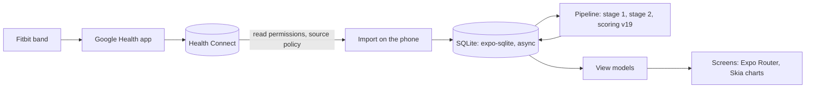

<div align="center">


# Pulse Mobile

**Recovery, strain and sleep from your Fitbit, scored on your Android phone.**

No server, no account, no cloud. Pulse Mobile reads your Fitbit data from Health Connect and keeps every byte on the phone.

[](https://github.com/adityaongit/pulse-mobile/actions/workflows/ci.yml)
[](https://github.com/adityaongit/pulse-mobile/releases/latest)
[](LICENSE)


[**Download the APK**](https://github.com/adityaongit/pulse-mobile/releases/latest) · [**Website**](https://pulse.portlabs.in) · [**Pulse (self-hosted)**](https://github.com/adityaongit/pulse) · [**Metrics**](https://pulse.portlabs.in/metrics/)

</div>

## What you get

- **Sleep, Recovery and Strain** each morning, with a Strain Target set by how recovered you are.
- **Pulse Age** and its pace: how old your body is behaving, and whether that is speeding up.
- **Stress** and **Energy Bank** through the day.
- **Health Monitor**: last night's vitals against your normal range.
- **Journal** and **Log**: water, food, weight and mood, and what moves tomorrow's Recovery.
- **Activities and workouts**, **Trends**, weekly and monthly **Reports**, and **My Dashboard**.

How each score is computed: [the metrics](https://pulse.portlabs.in/metrics/).

## Install

1. Download `…-arm64-v8a.apk` from the [latest release](https://github.com/adityaongit/pulse-mobile/releases/latest). It fits nearly every Android phone since 2017; [docs/releases.md](docs/releases.md) lists the other builds.
2. Open it. Android asks once to allow installs from your browser or file manager, and Play Protect may ask to scan an app from an unknown developer: both are normal for an app from outside the Play Store.
3. In the Google Health app, let it share your data with Health Connect.
4. Open Pulse, enter your profile, tap **Connect Health Connect** and allow every permission, including access to past data. The first import reads the last 180 days.

Pulse only reads Health Connect and never writes to it.

## How it works



The engine (Health Connect source, storage, scoring and view models) comes from halo, a fork of the same Pulse app; the screens keep Pulse's own look. The plan is in [docs/rewrite-plan.md](docs/rewrite-plan.md).

## Pulse Mobile or Pulse?

| | **Pulse Mobile** (this repo) | **[Pulse](https://github.com/adityaongit/pulse)** |
|---|---|---|
| Runs | On your Android phone | On a server you host, in the browser or its app shell |
| Data | Only on the phone | On your server |
| Source | Fitbit through Health Connect | The Google Health API |
| Accounts | None: one install is one person | One server, many people |

Pulse Mobile imports what Health Connect holds, up to the last 180 days. It does not carry over a Pulse server's history.

## Build from source

You need Node 24, [pnpm](https://pnpm.io) and, for a local build, Android Studio.

```sh
git clone https://github.com/adityaongit/pulse-mobile.git && cd pulse-mobile
pnpm install
pnpm android        # builds a development build and runs it on a phone or emulator
```

Health Connect is a native module, so the app needs a [development build](https://docs.expo.dev/develop/development-builds/introduction/), not Expo Go. A cloud build works too: `npx eas-cli@latest build --profile development`. This project is on Expo SDK 57; Expo changes every SDK, so check [the current docs](https://docs.expo.dev/llms.txt) before touching an Expo API.

| Command | What it does |
|---|---|
| `pnpm start` | Dev server |
| `pnpm android` | Build and run a development build on Android |
| `pnpm typecheck` | `tsc --noEmit` |
| `pnpm lint` | ESLint |
| `pnpm test` | Vitest in Node |
| `npx expo install <pkg>` | Add a dependency (use this, not `pnpm add`) |
| `npx expo-doctor` | Check dependencies and config |

## Documentation

| Guide | What it covers |
|---|---|
| [AGENTS.md](AGENTS.md) | Commands, layout and rules for contributors and coding agents |
| [Releases](docs/releases.md) | Building the APKs and publishing a release |
| [First run](docs/onboarding.md) | What happens the first time the app opens |
| [Rewrite plan](docs/rewrite-plan.md) | The move to Health Connect and halo's engine |
| [Design spec](docs/design/spec.md) | The UI contract |
| [Learning notes](docs/learning.md) | The React Native and Expo choices made here, and why |

## Contributing and security

- [Contributing](CONTRIBUTING.md): set up, how changes land, the rules of the codebase.
- [Security policy](SECURITY.md): report vulnerabilities privately.
- [Code of Conduct](CODE_OF_CONDUCT.md).

## License

[PolyForm Noncommercial 1.0.0](LICENSE). Use it, change it and share it for any noncommercial purpose. Selling it, or putting it inside a commercial product, is not allowed.

Pulse Mobile is an independent project. It is not affiliated with, endorsed by or connected to Fitbit, Google,
WHOOP, Bevel, Garmin or any other wearable maker. The code names other products only to cite what they publish.
