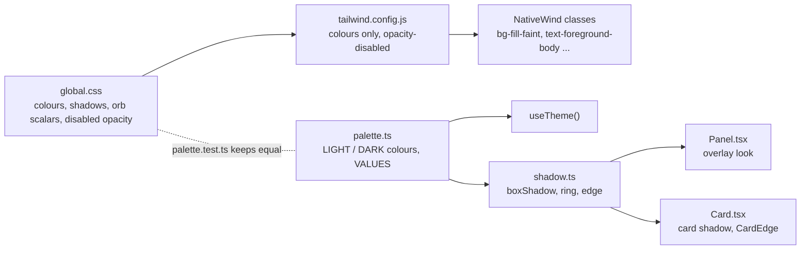

# Theme token audit, 2026-10-10

Scope: `src/ui/**`, `src/screens/**`, `app/**` (215 files; `src/core`, synced `src/lib`, tests, `app/dev/**` skipped; `app/dev/**` has no raw hex or rgba, so it is clean). Read-only audit, no code changed. Web reference: `/Users/adityajindal/personal/pulse/src/app/globals.css`.

Rule under test: every colour and theme value comes from a token in `global.css` (classes via `tailwind.config.js`, JS via `palette.ts` / `useTheme()`), so one theme edit reaches every use.

## Headline

The colour layer is in good shape: 0 raw hex in className, 0 `bg-[#...]`, and all 123 tokens in `global.css` equal the web's values in both themes (checked by script; the only differences are web `var()` aliases and `color-mix()` written out as plain values, as the file header says). `palette.ts` is held equal to `global.css` by `palette.test.ts`.

What leaks is not the palette. It is **shadows and ring colours written as raw `rgba()` per scheme**, **one flat-ground colour pair**, **opacity tricks that the web also uses but that are scattered as bare numbers**, and **kit pieces re-typed as class strings in screens**. The web keeps shadows (`--card-shadow`, `--thumb-shadow`, `--overlay-shadow`, `--glass-shadow`), `--ground-healthspan`, `--pattern-hatch`, `--selection` and the orb scalars as tokens; mobile has none of the first four as tokens.

## Summary

| # | Category | Instances | Highest severity | Notes |
|---|----------|-----------|------------------|-------|
| 1 | Raw colours (hex, rgba, named) | 27 lines | high | 12 are shadow/ring rgba, 2 flat-ground hex, 3 error-screen, 2 tailwind config; 4 are Google brand logo (keep) |
| 2 | Opacity tricks / alpha written many ways | 109 class modifiers + 50 `alpha()` calls | medium | Same web habit, but no semantic names; drift between 0.04/0.045/0.05/0.06/0.07/0.08 for "inset fill" |
| 3 | Duplicated literals that are tokens | 62 lines | high | shadows (11), radii (22), durations (27), halo/ground/header numbers (5), stroke widths (1 token worth) |
| 4 | Token sync (palette / global.css / web) | 11 items | high | 4 web tokens missing on mobile (shadows), 1 ground, hatch, selection, orb scalars live in a TS object |
| 5 | Looks re-typed instead of shared | 41 sites in 8 patterns | medium | inset row, secondary row, field, segmented, card button, popover panel, card edge overlay, skeleton fill |

## Proposed new tokens

Values from the web `globals.css` unless noted. Add to `global.css` (light in `:root`, dark in `.dark:root`), to `palette.ts`, and to the `palette.test.ts` check.

| Token | Light | Dark | Replaces | Source |
|-------|-------|------|----------|--------|
| `--card-shadow` | `0 1px 2px rgb(16 21 24 / 0.05), 0 0 0 1px rgb(16 21 24 / 0.05)` | `0 0 #0000` | Card.tsx:37 | web 459 / 318 |
| `--overlay-shadow` | `0 8px 24px rgb(16 21 24 / 0.14)` | `0 8px 24px rgb(0 0 0 / 0.45)` | 6 popover/menu/tooltip sites (cat. 1) | web 461 / 320 |
| `--thumb-shadow` | `0 1px 3px rgb(16 21 24 / 0.3)` | `0 1px 3px rgb(0 0 0 / 0.4)` | Slider.tsx:62 | web 460 / 319 |
| `--glass-shadow` | `0 10px 30px rgb(16 21 24 / 0.12), 0 2px 6px rgb(16 21 24 / 0.08)` | `0 10px 30px rgb(0 0 0 / 0.5), 0 2px 6px rgb(0 0 0 / 0.35)` | Glass.tsx:25 | web 450 / 306 |
| `--ground-healthspan` (as a flat colour, `--ground-flat`) | `238 241 243` (#eef1f3) | `16 21 24` (#101518) | Ground.tsx:9 | web `--ground-healthspan` |
| `--hatch-stripe` (web `--pattern-hatch` stripe colour) | `rgb(16 21 24 / 0.08)` | `rgb(255 255 255 / 0.09)` | Hatch.tsx:15 | web 443 / 295 |
| `--selection` | `rgb(16 21 24 / 0.16)` | `rgb(255 255 255 / 0.25)` | none today (controls.tsx:84, fields.tsx:21 use `c.foreground`) | web 458 / 317 |
| `--overlay-ring` | `rgb(16 21 24 / 0.1)` | `rgb(255 255 255 / 0.1)` (equals `--border`; reuse `border` if the web does) | InfoDialog:37, ChartFrame:233, ActivityMenu:48, TrendMetricMenu:42, DismissDialog:27 | mobile-only; web uses `ring-foreground/10` |
| `--fill-faint` | `foreground / 0.06` | `foreground / 0.06` | the 0.04/0.045/0.06/0.07 "inset fill" family (cat. 2A) | mobile naming; web writes bg-foreground/[0.06] 21 times |
| `--fill-hover` | `foreground / 0.08` | `foreground / 0.08` | `bg-foreground/8` and `/[0.08]` (13 sites) | web 23 uses |
| `--fill-pressed` | `foreground / 0.10` | `foreground / 0.10` | `bg-foreground/10` (7 sites) | web 13 uses |
| `--skeleton` | `muted / 0.6` | `muted / 0.6` | `bg-muted/60` (14 sites) | web 13 uses |
| `--disabled-opacity` (as a tailwind `opacity-disabled`) | 0.4 | 0.4 | `opacity-40`/`opacity-50` on disabled items | mobile; web varies |
| `--shadow-lifted` | (new, no web token) | (new) | EditDashboard.tsx:237 `0 8px 24px rgb(0 0 0 / 0.35)`; reuse `--overlay-shadow` instead | |
| Motion: `fast 150`, `base 200/220`, `overlay 300/320`, easings `standard (0.2,0,0,1)`, `out-expo (0.16,1,0.3,1)`, `in-quick (0.4,0,1,1)` | n/a | n/a | 27 duration literals, 3 easing literals | web `--ease-*` and spec §2.7; export from `src/ui/motion.ts` |
| Radius scale in JS (`RADIUS = {chip: 8, row: 10, button: 12, card: 16, panel: 24, sheet: 28}`) | n/a | n/a | borderRadius: 16, radius={28}, RADIUS = 28, arbitrary `rounded-[Npx]` | already in tailwind.config.js; export the same numbers |
| Shell metrics (`GROUND_STOPS = [270, 740]`, `HEADER_FADE = 24`) | n/a | n/a | Ground.tsx:21-28,35-37 | web `--ground` gradient |

Delete or re-point: tailwind.config.js `white: "#ffffff"` / `black: "#000000"` (point at `on-media` / `media-ground`, or drop them).

## Category 1: Raw colours

### 1A. Shadows and rings written as rgba per scheme (high)

| file:line | literal | should be |
|-----------|---------|-----------|
| src/ui/Card.tsx:37 | `"0 1px 2px rgba(16, 21, 24, 0.05), 0 0 0 1px rgba(16, 21, 24, 0.05)"` (light card shadow) | `--card-shadow` (web light value) |
| src/ui/Glass.tsx:25 | `"0 10px 30px rgba(0, 0, 0, 0.5), 0 2px 6px rgba(0, 0, 0, 0.35)"` and light twin | `--glass-shadow` |
| src/ui/Toast.tsx:72 | `"0 4px 12px rgba(0, 0, 0, 0.1)"` (no web token; scheme-blind) | `--overlay-shadow` |
| src/ui/shells/InfoDialog.tsx:37 | ring `rgba(255,255,255,.08)` / `rgba(16,21,24,.08)` plus shadow `0 8px 24px rgba(0,0,0,.45)` / `rgba(16,21,24,.14)` | `--overlay-ring` + `--overlay-shadow` (ring drifts: .08 here, .1 elsewhere) |
| src/ui/charts/ChartFrame.tsx:233 | `inset 0 0 0 1px ${alpha(c.foreground, 0.1)}, 0 8px 24px rgba(0,0,0,.45)` / `rgba(16,21,24,.14)` | `--overlay-ring` + `--overlay-shadow` |
| src/screens/journal/DismissDialog.tsx:27 | `inset 0 0 0 1px ${c.border}, 0 8px 24px rgba(0,0,0,.45)` / `rgba(16,21,24,.14)` | `--overlay-shadow` (ring uses `c.border`, a third spelling) |
| src/screens/activity/ActivityMenu.tsx:48 | ring `rgba(255,255,255,.1)` / `rgba(16,21,24,.1)` plus overlay shadow pair | `--overlay-ring` + `--overlay-shadow` |
| src/screens/trends/TrendMetricMenu.tsx:42 | `0 0 0 1px ${alpha(c.foreground, .1)}, 0 8px 24px rgba(0,0,0,.45)` / `rgba(16,21,24,.14)` | `--overlay-ring` + `--overlay-shadow` |
| src/screens/journal/Slider.tsx:62 | `0 1px 3px rgba(0, 0, 0, 0.4)` dark / `alpha(c.foreground, 0.3)` light | `--thumb-shadow` |
| src/screens/home/EditDashboard.tsx:237 | `"0 8px 24px rgba(0, 0, 0, 0.35)"` (lifted row; scheme-blind, .35 matches no token) | `--overlay-shadow` |
| src/ui/metrics/DriverList.tsx:125 | `"inset 0 0 0 1px rgba(255, 255, 255, 0.6)"` (selected ring) | new `--selected-ring`, or `alpha(c.foreground, .6)`; white is wrong in light |
| src/ui/metrics/DriverList.tsx:126 | `ring="rgba(255, 255, 255, 0.6)"` (same ring, second copy) | same token |

### 1B. Flat colours (high / medium)

| file:line | literal | should be | sev |
|-----------|---------|-----------|-----|
| src/ui/Ground.tsx:9 | `"#101518"` / `"#eef1f3"` flat Healthspan ground | `--ground-flat` token (web `--ground-healthspan`); a theme edit to the ground misses this screen | high |
| src/ui/Hatch.tsx:15 | `"rgba(255, 255, 255, 0.09)"` / `"rgba(16, 21, 24, 0.08)"` stripe | `--hatch-stripe` | high |
| app/_layout.tsx:47 | `bg-white ... dark:bg-black` migration-error screen | `bg-background` | medium |
| app/_layout.tsx:48 | `text-red-600` (not even a Pulse token; tailwind palette is replaced, so this class generates nothing) | `text-destructive` | medium |
| tailwind.config.js:~30 | `white: "#ffffff", black: "#000000"` in `colors` | `on-media` / `media-ground`, or remove | medium |
| src/screens/health/AgeOrb.tsx:318 | `Skia.Color("white")` (initial particle colour, overwritten each frame) | `Skia.Color(c["orb-highlight"])` or transparent | low |
| src/ui/fontClasses.ts:35 | regex lists `"white"`, `"black"` as colour classes | drop with the tailwind config entries | low |
| src/screens/settings/GoogleFit.tsx:7-10 | `#EA4335 #34A853 #FBBC05 #4285F4` | keep: third-party brand logo, must not follow the theme | n/a |

### 1C. Computed rgba (not a finding, listed so the sweep is auditable)

`src/ui/color.ts:3,19`, `src/screens/health/orb.ts:80,97`, `src/screens/health/AgeOrb.tsx:174,199-218` build rgba strings from palette tokens at runtime. They follow the theme. `AgeOrb.tsx` numeric alphas (0.36/0.22/0.07 halo stops, 0.85 edge, 0.07+0.03i rim) are orb art constants; keep them in `orb.ts` (low).

## Category 2: Opacity tricks and alpha written several ways

The web uses the same modifiers (`bg-foreground/8` 23x, `/[0.06]` 21x, `bg-muted/60` 13x), so these are not drift from the web. The finding is that the same meaning ("faint fill", "hover fill", "skeleton") has no name, and the same intent is written 0.04 / 0.045 / 0.05 / 0.06 / 0.07 / 0.08 in different places.

### 2A. `foreground` as a surface fill (medium)

| Literal | Count | Sites | Proposed |
|---------|-------|-------|----------|
| `bg-foreground/[0.04]` | 2 | settings/DataSource.tsx:267, shells/DateSwitcher.tsx:83 | `bg-fill-faint` |
| `bg-foreground/[0.045]` | 1 | shells/HomeHeader.tsx:99 | `bg-fill-faint` (drift: .045) |
| `bg-foreground/[0.06]` | 9 | activity/ActivitiesScreen.tsx:76, home/EditDashboard.tsx:45,144, reports/ReportsScreen.tsx:91, settings/controls.tsx:58,59,136, settings/DataSource.tsx:255, kit/KitScreen.tsx:119 | `bg-fill-faint` |
| `bg-foreground/[0.07]` | 3 | home/EditDashboard.tsx:25, journal/CheckInPage.tsx:298, metrics/DayStrip.tsx:76 | `bg-fill-faint` (drift: .07) |
| `bg-foreground/[0.08]` | 5 | home/HomeInsight.tsx:77,83, home/HomeSkeleton.tsx:54, shells/CalendarPanel.tsx:121, shells/DateSwitcher.tsx:90 | `bg-fill-hover` |
| `bg-foreground/8` | 8 | activity/ActivityMenu.tsx:33, journal/CheckInPage.tsx:233, onboarding/BirthDatePicker.tsx:125, onboarding/TimeZonePicker.tsx:106, kit/KitScreen.tsx:74, shells/DetailHeader.tsx:41, shells/InfoDialog.tsx:61, shells/TaskPage.tsx:113 | `bg-fill-hover` (the same value as `[0.08]` written two ways) |
| `bg-foreground/10` | 7 | activity/ActivityMenu.tsx:26, home/PlusMenu.tsx:42, trends/TrendMetricMenu.tsx:45, trends/TrendViewScreen.tsx:114, charts/ZoneBars.tsx:116, metrics/DayStrip.tsx:76, shells/TaskPage.tsx:36 | `bg-fill-pressed` / divider |
| `bg-foreground/[0.12]` | 1 | metrics/SleepStages.tsx:79 | `bg-fill-pressed` |
| `bg-foreground/15` `/20` `/30` `/35` `/45` | 1 each | journal/Slider.tsx:56, metrics/ContributorRow.tsx:90,163, sleep/SleepCards.tsx:203,114 | data-viz neutrals: name `--track-neutral` (low) |
| `bg-foreground/80` | 4 | sleep/SleepCards.tsx:72,116,276, metrics/SleepCard.tsx:29 | name `--bar-neutral` (low) |
| `bg-foreground/90` | 1 | home/HomeSkeleton.tsx:101 | `bg-foreground` (skeleton of an ink button) |
| `border-foreground/[0.06]` | 1 | onboarding/BirthDatePicker.tsx:139 | `border-border` is .1; pick one hairline (medium) |
| `border-foreground/15` `/25` `/30` `/45` `/55` `/75` `/80` `/90` | 1,2,1,1,1,1,2,1 | metrics/TrendLegend.tsx:16, home/HomeScreen.tsx:274, home/HomeSkeleton.tsx:113, metrics/SleepStages.tsx:221,79,153, shells/CalendarPanel.tsx:165, sleep/SleepCards.tsx:182, more/BehaviorPicker.tsx:122, charts/ZoneBars.tsx:116 | selected/outlined states; name `--outline-strong` (low) |
| `ring-foreground/70` | 2 | settings/controls.tsx:64, ui/Button.tsx:22 | `--focus-ring` (low) |

### 2B. Skeleton and card fills (medium)

| Literal | Count | Sites | Proposed |
|---------|-------|-------|----------|
| `bg-muted/60` | 14 | activity/ActivityScreen.tsx:251, health/FitnessScreen.tsx:193, home/HomeSkeleton.tsx:135,153, sleep/NapSkeleton.tsx:68, sleep/SleepSkeleton.tsx:87, trends/WeeklyTrends.tsx:52, charts/ColumnChart.tsx:100, charts/Hypnogram.tsx:125, charts/IntradayHrChart.tsx:159, charts/SleepHrChart.tsx:140, charts/StrainRecoveryChart.tsx:125, charts/TrendChart.tsx:397, metrics/SleepStages.tsx:227 | `bg-skeleton` (or a `<SkeletonAlt>` variant of `Skeleton`) |
| `bg-muted/50` | 1 | settings/controls.tsx:224 | `bg-skeleton` (drift: .5) |
| `bg-card/60` | 2 | home/HomeInsight.tsx:49, home/HomeSkeleton.tsx:47 | `--card-stack` for the "next card peeking" strip |
| `bg-input/30` | 4 | settings/controls.tsx:60,61, ui/Button.tsx:18,19 | `--field-outline-fill` (dark-only, matches web `dark:bg-input/30`) |
| `bg-input/80` | 1 | settings/controls.tsx:158 | switch track; web identical, low |
| `text-foreground/85` | 10 | _lib/info.tsx:11, activity/ActivitiesScreen.tsx:77, health/info.tsx:10, home/HomeInsight.tsx:63, home/HomeScreen.tsx:60,61, journal/History.tsx:54, reports/ReportsScreen.tsx:92, shells/InfoDialog.tsx:47, shells/LinkList.tsx:28 | `text-body` (a third text tier between foreground and foreground-secondary) |
| `text-muted-foreground/60` | 1 | charts/TrendChart.tsx:392 | `text-faint` (low) |

### 2C. Status colours as tints (medium)

| Literal | Sites | Proposed |
|---------|-------|----------|
| `bg-optimal/15` | health/HealthScreen.tsx:122, home/HomeScreen.tsx:367 | `bg-optimal-soft` |
| `bg-optimal/20` | metrics/DayStrip.tsx:89, metrics/DriverList.tsx:71 | `bg-optimal-soft` (drift: .2) |
| `bg-warning/15` | health/HealthScreen.tsx:122, home/HomeScreen.tsx:369 | `bg-warning-soft` |
| `bg-warning/20` | metrics/DriverList.tsx:60 | `bg-warning-soft` (drift) |
| `bg-stress-low/15` `-medium/15` `-high/15` | home/HomeScreen.tsx:51,52,53 | `bg-stress-*-soft` |
| `bg-recovery-red/10` | settings/DeleteEverything.tsx:42 | `bg-destructive-soft` |
| `bg-recovery-red/15` | log/fields.tsx:81 | `bg-destructive-soft` (drift: .15 vs .10) |
| `border-recovery-red/45` | settings/DeleteEverything.tsx:42 | `border-destructive-soft` |
| `ring-recovery-red/60` | home/HomeScreen.tsx:291 | one alert ring (HomeScreen.tsx:292 computes `illness ? 0.6 : 0.5` in JS: same intent, two spellings) |
| `bg-optimal/60` `bg-warning/60` | metrics/TickScale.tsx:34 | `--*-mid` or accept (low) |
| `bg-sleep/85` | metrics/SleepCard.tsx:28 | low |

### 2D. `alpha(c.token, n)` in JS (50 calls; medium for repeated, low for chart-local)

| Literal | Sites | Note |
|---------|-------|------|
| `alpha(c.foreground, 0.05)` x3 | charts/ColumnChart.tsx:67, charts/TrendChart.tsx:238, metrics/Sparkline.tsx:36 | chart baseline; `--chart-grid` is .08, `--chart-band` .04: use them |
| `alpha(c.foreground, 0.04)` x2 | charts/ColumnChart.tsx:77, charts/TrendChart.tsx:280 | equals `--chart-band` |
| `alpha(c.foreground, 0.06)` | charts/StrainRecoveryChart.tsx:88 | |
| `alpha(c.foreground, 0.07)` | charts/Hypnogram.tsx:69 | equals `--chart-highlight` |
| `alpha(c.foreground, 0.1)` x3 | journal/CheckInPage.tsx:52, trends/TrendMetricMenu.tsx:42, charts/ChartFrame.tsx:233 | = `--border` (light) / overlay ring |
| `alpha(c.foreground, 0.16)` + `0.02` | shells/TabBar.tsx:42 | tab-selection gradient; name `--tab-pill-from/to` |
| `alpha(c.foreground, 0.2)` | home/TonightPlan.tsx:47 | dashed line |
| `alpha(c.foreground, 0.22)` | charts/Hypnogram.tsx:71 | |
| `alpha(c.foreground, 0.25)` | shells/TaskPage.tsx:157 | sheet handle; name `--sheet-handle` |
| `alpha(c.foreground, 0.3)` | journal/Slider.tsx:62 | thumb shadow (see 1A) |
| `alpha(c.foreground, 0.35)`, `0`, `0.55` | sleep/SleepCards.tsx:70,214 | baseline gradient |
| `alpha(c.foreground, 0.7)` x3 | onboarding/BirthDatePicker.tsx:116, settings/controls.tsx:69, ui/Button.tsx:61 | = `ring-foreground/70` (class form at controls.tsx:64, Button.tsx:22): one focus ring, two spellings |
| `alpha(c.foreground, 0.8)` | journal/CheckInPage.tsx:53 | |
| `alpha(c.foreground, 0)` | sleep/SleepCards.tsx:70 | gradient start |
| `alpha(c.input, 0.3)` x2 | log/DateTimeField.tsx:50, log/fields.tsx:24 | = `bg-input/30` (class form in controls.tsx and Button.tsx): same fill, two spellings; also gated on `scheme === "dark"` in JS |
| `alpha(c.field, 0.65)`, `0` | onboarding/BirthDatePicker.tsx:101,102 | picker fade |
| `alpha(c["background-mid"], 0)` | more/BehaviorPicker.tsx:94 | list fade |
| `alpha(c.card, 1)` | charts/StrainRecoveryChart.tsx:82 | no-op alpha; use `c.card` |
| `alpha(c.warning, 0.6)`, `alpha(c["chart-2"], 0.6)` | health/LoadChart.tsx:63,64 | |
| `alpha(c.warning, 0.5)` x2 | metrics/KeyStatRow.tsx:149,157 | ring; HomeScreen.tsx:292 uses the same colour at .5/.6 |
| `alpha(c["recovery-red"], 0.6)` | health/MonitorScreen.tsx:104 | alert ring: third copy of the red alert ring |
| `alpha(c["action-rim-from"], 0.25)` | ui/Glass.tsx:26 | glass action rim; name `--glass-action-rim` |
| `alpha(c.sleep, 0)` | sleep/SleepCards.tsx:85 | |
| `alpha(c["dial-target"], 0.3)` | charts/TrendChart.tsx:235 | |
| `alpha(ring, 0.35)` | settings/controls.tsx:71 | field focus halo |
| `alpha(fill, 0.22)` | charts/ChartFrame.tsx:74 | active dot halo |
| `alpha(r.fill, 0.5)` | charts/TrendChart.tsx:266 | |
| `alpha(edge, 0)`, `alpha(low, 0)` | shells/Header.tsx:66,70 | header fade; correct (transparent twin of a token) |
| `alpha(c["orb-core"], a)` x2 | health/AgeOrb.tsx:354,370 | orb art |
| `alpha(color, from/to)` | charts/paint.tsx:35 | generic |
| `alpha(css(...), ...)` | charts/spans.tsx:33 | |

### 2E. Opacity utilities for state (low)

`opacity-40` (disabled/empty): reports/ReportScreen.tsx:64,86, charts/ZoneBars.tsx:99. `opacity-50` (disabled): health/StressScreen.tsx:58, settings/controls.tsx:158, ui/Button.tsx:60, shells/CalendarPanel.tsx:140. `opacity-70`: home/HomeScreen.tsx:307, home/parts.tsx:38, shells/DateSwitcher.tsx:76, shells/SectionShell.tsx:37. `opacity-80`: metrics/ContributorRow.tsx:189. `opacity-35 /25 /75`: shells/DateSwitcher.tsx:76. Disabled is 0.4 in three files and 0.5 in four: one `opacity-disabled`.

## Category 3: Duplicated literals that are design tokens

### 3A. Shadows (high), see 1A

The overlay shadow is typed 6 times (InfoDialog:37, ChartFrame:233, DismissDialog:27, ActivityMenu:48, TrendMetricMenu:42, plus Toast:72 and EditDashboard:237 with other values). The card edge overlay is typed 2 times (Card.tsx:25, home/parts.tsx:52). Add a `useShadow()` / `shadow-*` helper that reads the `--*-shadow` tokens, or NativeWind `shadow-card`, `shadow-overlay`, `shadow-thumb`, `shadow-glass` mapped to the CSS variables (as the web's `@theme inline` does at lines 117-121).

Other box-shadow literals that are rings, not shadows (low): `inset 0 0 0 1px` x10 (Card.tsx:25,46, DriverList.tsx:125, KeyStatRow.tsx:155 via shadow.boxShadow, controls.tsx:210, InfoDialog.tsx:37, DismissDialog.tsx:27, ActivityMenu.tsx:48, ChartFrame.tsx:233, HomeScreen.tsx:294), `inset 0 0 0 2px` x2 (DayStrip.tsx:77, controls.tsx:53), `0 0 0 2px` (SyncStatus.tsx:49 dot knockout in `background-top`), `0 0 0 1px` (Button.tsx:61, TrendMetricMenu.tsx:42).

### 3B. Radii (medium / low)

tailwind.config.js defines the web scale (sm 4, md 8, lg 10, xl 12, 2xl 16, 3xl 24, 4xl 28). Literals that bypass it:

| file:line | literal | should be |
|-----------|---------|-----------|
| src/ui/Card.tsx:25 | `borderRadius: 16` | `RADIUS.card` (CARD_CLASS says `rounded-2xl`; the overlay can drift from it) |
| src/screens/home/parts.tsx:52 | `borderRadius: 16` | same |
| src/ui/shells/sheets.ts:30 | `const RADIUS = 28` | `RADIUS.sheet` |
| src/screens/activity/CoachGlance.tsx:63 | `<Glass radius={28}>` | `RADIUS.sheet` |
| src/ui/shells/TabBar.tsx:52 | `<Glass radius={22}>` | new `RADIUS.glass` |
| src/ui/shells/CheckInAction.tsx:55 | `<Glass radius={22}>` | same (FAB = TAB_BAR_HEIGHT 62, so 22 is not a circle; keep one const) |
| src/ui/shells/TabBar.tsx:41,72 | `borderRadius: 18`, `rounded-[18px]` | `RADIUS.glass - 4` derived |
| src/ui/charts/ChartFrame.tsx:144 | `borderRadius: 9` (18 px pill) | `rounded-full` equivalent |
| src/ui/Button.tsx:26 | `rounded-[11px]` | inner radius = button radius - 1; derive |
| src/ui/metrics/InsightCard.tsx:24 | `rounded-[15px]` | inner = card radius - 1; derive |
| src/screens/settings/controls.tsx:100 | `rounded-[14px]` | `rounded-2xl`-1 or add `rounded-3xl-ish`; also SettingsScreen.tsx:59 |
| src/screens/settings/controls.tsx:114 | `rounded-[10px]` | `rounded-lg` |
| src/screens/home/PlusMenu.tsx:31, src/screens/home/HomeSkeleton.tsx:101 | `rounded-[10px]` x2 | `rounded-lg` |
| `rounded-[2px]` x11, `rounded-[3px]` x9, `rounded-[4px]` x5, `rounded-[1px]` x1, `rounded-tl-[3px]` x1 | metrics/TrendLegend.tsx:16,18; BreakdownBar.tsx:33; ContributorRow.tsx:160,212; SleepStages.tsx:87,161,162,227; charts/TrendChart.tsx:354,360; ZoneBars.tsx:72,111,112,198; ChartFrame.tsx:246; journal/DayLog.tsx:64; sleep/SleepCards.tsx:21,50,203,276; sleep/SleepSkeleton.tsx:32,36,86,87; health/LoadChart.tsx:113; shells/DetailShell.tsx:102 | swatch radius: add `rounded-swatch` (2) and `rounded-bar` (3); `rounded-sm` is 4 |
| `rounded-[2px]` in CheckInPage.tsx:56 | `rounded-[` (size-11 radio) | `rounded-xl` check |

Native sheet radius (`sheetCornerRadius: RADIUS`) cannot use a class; it must read the shared JS constant.

### 3C. Durations and easings (medium)

Web: fast 150, base 220, overlay 320 / 200; easings `--ease-standard (0.2,0,0,1)`, `--ease-out-expo (0.16,1,0.3,1)`, `--ease-in-quick (0.4,0,1,1)`.

| Literal | Sites |
|---------|-------|
| 150 ms | shells/CollapsibleSection.tsx:29, shells/TabBar.tsx:37, shells/ScreenScroll.tsx:16 (`durationOut`), settings/controls.tsx:146, home/HomeInsight.tsx:21, home/EditDashboard.tsx:204,225, ui/Toast.tsx:68 (exit), health/ContributorCard.tsx:96 (exit), more/Behaviours.tsx:120 (exit) |
| 200 ms | shells/CalendarPanel.tsx:61,66, settings/DataSource.tsx:60, health/ContributorCard.tsx:48,77,96, trends/parts.tsx:51, more/Behaviours.tsx:120 |
| 220 ms | shells/ScreenScroll.tsx:16 (`durationIn`) |
| 300 ms | ui/Toast.tsx:67, shells/DoneScreen.tsx:29,34 |
| 120 ms | home/EditDashboard.tsx:188,203 |
| 100 ms delay | shells/DoneScreen.tsx:34 |
| spinner 900 / 1000 ms linear | settings/DataSource.tsx:106, journal/CheckInPage.tsx:39 (two spinners, two speeds) |
| `Easing.bezier(0, 0, 0.2, 1)` + 1500/500 | health/LastReading.tsx:21 |
| `Easing.bezier(0.16, 1, 0.3, 1)` | health/AgeOrb.tsx:410 (= `--ease-out-expo`) |
| orb entry 1.2 s / 0.35 s | health/orb.ts:59 (art, keep) |

Proposed: `src/ui/motion.ts` exporting `DURATION = { fast: 150, base: 220, overlay: 320, overlayOut: 200 }` and `EASE`, used by all of the above.

### 3D. Chart, ground and header numbers (medium / low)

| file:line | literal | should be |
|-----------|---------|-----------|
| src/ui/Ground.tsx:21,27,35,36,37 | `740`, `270`, `270 / 740` (web `--ground` stops) | `GROUND = { mid: 270, end: 740 }` shared with `groundColorAt` (already the same numbers twice in one file) |
| src/ui/shells/Header.tsx:20 | `HEADER_FADE = 24` | fine as a named const; keep |
| src/ui/charts/ChartFrame.tsx:121 | `textShadowRadius: 3, textShadowOffset 0/0` (label halo) | `CHART.halo` const (halo colour is `c.card`, set in StrainRecoveryChart.tsx:82 and TrendViewChart.tsx:77, two copies of the choice) |
| src/ui/shells/TaskPage.tsx:110 | handle `h-1.5 w-10 mt-2.5` | shared with web drawer, keep |
| src/ui/shells/layout.ts:4-5 | `TAB_BAR_HEIGHT = 62`, `FAB_SIZE = 62` | good: already shared |
| Stroke widths | `strokeWidth` literals: 1.75 x45 (icons; `Icon.tsx:10` default), 2 x36, 1.5 x19, 2.5 x13, 2.25 x9, 3 x8, 1 x7, 0 x3, plus 1.6, 1.25, 14 | icon stroke 1.75 is the token: 40+ call sites repeat the default of `Icon`; chart line widths 1.5/2/2.5 deserve `CHART.line` consts (low) |
| Border widths | `border` (1 px) everywhere; `border-[5px]` x1 | fine |

### 3E. Type scale (low, the web does the same)

`text-[15px]` x105, `leading-[22px]` x77, `tracking-[0.1em]` x74, `text-[13px]` x72, `text-[11px]` x22, `tracking-[-0.01em]` x17, `text-[17px]` x14, `leading-[18px]` x14, `text-[22px]` x8, others <= 4. The web spells these as arbitrary values too; names (`text-body`, `text-label`, `tracking-caps`) would make a type change one edit. Out of scope for colour, listed for completeness.

## Category 4: Token sync (palette.ts, global.css, web)

| # | Finding | sev |
|---|---------|-----|
| 4.1 | `palette.ts` and `global.css` hold the same 123 names; `palette.test.ts` enforces it. No mismatch found. | ok |
| 4.2 | Colour values equal the web in light and dark for every shared token (script diff). The only differences are web `var(--x)` aliases (`stress-low`, `chart-5`, `answer-yes`, `*-text` in dark, `strain-band-1`) and `color-mix()` values written out (`chart-highlight`, `chart-faint`, `strain-band-2..4` dark = 78/58/40 % of `strain` over `card`; mobile 8 123 189 etc. checked, within rounding). Alias tokens duplicate a value: changing `recovery-blue` on mobile needs five edits (`recovery-blue`, `stress-low`, `answer-yes`, `chart-5`, `chart-faint`) where the web needs one. | medium |
| 4.3 | Missing from mobile (web has): `--card-shadow`, `--overlay-shadow`, `--thumb-shadow`, `--glass-shadow` | high |
| 4.4 | Missing: `--ground-healthspan` (hard-coded in Ground.tsx:9) | high |
| 4.5 | Missing: `--pattern-hatch` stripe colour (hard-coded in Hatch.tsx:15) | high |
| 4.6 | Missing: `--selection` (text selection colour; controls.tsx:84, fields.tsx:21 use `c.foreground`, so the selection is opaque ink) | low |
| 4.7 | `--orb-lift/-sparkle/-blend` live as a TS object in `health/orb.ts:64-67` (`ORB.theme`), not as tokens: a per-theme value outside the theme files | medium |
| 4.8 | `--radius: 0.625rem` (web shadcn base) not mirrored; unused on mobile | low |
| 4.9 | `tailwind.config.js` adds `white` / `black` as raw hex, bypassing tokens (cat. 1B) | medium |
| 4.10 | Mobile-only tokens with no web twin: `destructive`(web has it in dark only via shadcn), `answer-yes`, `on-color`, `on-strain`, `action-rim-from/to`, `on-media`, `media-ground`, `flame-*`, `chart-highlight`, `chart-faint`, `strain-band-1..4`. Fine; they mirror web values that the web writes with `color-mix()` or inlines. | ok |
| 4.11 | Tokens used with the opposite scheme inline: `scheme === "dark" ? alpha(c.input, 0.3) : "transparent"` (log/DateTimeField.tsx:50, log/fields.tsx:24), `scheme !== "dark"` returns null in CardFill (Card.tsx:21). Behaviour keyed on the scheme instead of a token (`--card-top` equals `--card` in light, so the early return is an optimisation that breaks if the light card-top ever differs). Same for `Hatch`, `Glass`, `Card`, overlay shadows: 11 sites branch on `scheme` to pick a literal. | medium |

Other scheme branches that are fine (they pick a native API value, not a colour): app/_layout.tsx:68,76 (`DarkTheme`, StatusBar), shells/TaskPage.tsx:155 (StatusBar), health/orb.ts:66 (`ORB.theme`), Glass.tsx:30 (`tint={scheme}`).

## Category 5: Looks re-typed instead of taken from a shared piece

| # | Pattern | Sites | Should be | sev |
|---|---------|-------|-----------|-----|
| 5.1 | Inset row `rounded-lg bg-inset px-3 py-2(.5/3)` | sleep/SleepScreen.tsx:81, sleep/SleepCards.tsx:47, sleep/SleepSkeleton.tsx:33,62, health/HealthScreen.tsx:152,304, _lib/view.tsx:58 (`LEGEND`), metric/sections.tsx:23 | `<InsetRow>` in `src/ui` (8 sites; padding already differs: py-2 / py-2.5 / py-3) | medium |
| 5.2 | Secondary row `rounded-lg bg-secondary px-3 py-2.5` | charts/ZoneBars.tsx:61,99,192, metrics/ActivityCard.tsx:44, metrics/DriverList.tsx:122, home/HomeScreen.tsx:477 | `<SecondaryRow>` | medium |
| 5.3 | Card button `h-12 w-full flex-row ... rounded-xl bg-secondary active:scale-[0.96]` | home/parts.tsx:14 (`CARD_BUTTON`), health/CardButton.tsx:11, trends/TrendViewScreen.tsx:91 | one `CardButton` (the first already exports a const, the other two retype it) | medium |
| 5.4 | Form field `h-13 rounded-xl bg-field px-4` | settings/controls.tsx:57, onboarding/BirthDatePicker.tsx:115,122, onboarding/ProfileForm.tsx:84, onboarding/TimeZonePicker.tsx:80, log/fields.tsx (own style object, line 24) | `FIELD` class const exported once from `controls.tsx` and reused; `fields.tsx` and `DateTimeField.tsx` build the same input with JS styles (alpha + scheme) instead of the class | medium |
| 5.5 | Segmented control | ui/Segmented.tsx:41, journal/insights.tsx:48, reports/ReportScreen.tsx:70,86, activity/ActivitiesScreen.tsx:64 (`PILL`), settings/controls.tsx:100,114 | Segmented.tsx is the kit piece; 4 others re-implement `h-10 min-w-11 rounded-md px-N, on && bg-secondary` | medium |
| 5.6 | Popover/dialog panel (`bg-popover` + ring + overlay shadow + radius) | shells/InfoDialog.tsx:36, journal/DismissDialog.tsx:26, log/DateTimeField.tsx:65 (no ring, no shadow), settings/controls.tsx:210 (ring only), activity/ActivityMenu.tsx:43, trends/TrendMetricMenu.tsx:42, charts/ChartFrame.tsx:228 (tooltip), ui/Toast.tsx:71 | one `<Panel radius="3xl"|"2xl"|"xl">` that applies `--overlay-ring` and `--overlay-shadow`; today each picks its own ring alpha and shadow | high |
| 5.7 | Card edge overlay (lit top edge over a gradient child) | ui/Card.tsx:25, home/parts.tsx:52 (`GradientBanner`) | `<CardEdge>` component used by both; the `borderRadius: 16` is typed in both | medium |
| 5.8 | Skeleton fills `bg-muted/60` over `Skeleton`'s own `bg-muted` | 14 sites in 2B | `<Skeleton tone="alt">` | low |
| 5.9 | Card-class bypass: `rounded-xl bg-card px-4 py-1` | ui/kit/KitScreen.tsx:147 (`ROWS`) | `CARD_CLASS` (kit screen only, low) | low |
| 5.10 | Alert ring red: `ring-recovery-red/60` (HomeScreen.tsx:291) + `alpha(recovery-red, 0.6)` (MonitorScreen.tsx:104) + `alpha(illness ? ... , illness ? 0.6 : 0.5)` (HomeScreen.tsx:292) + warning ring `alpha(c.warning, 0.5)` (KeyStatRow.tsx:149,157) | 3 files | `<Card ring={alertRing("danger"|"warn")}>`; `Card` already takes `ring` | medium |
| 5.11 | Native chrome colours: `refreshControl tintColor/colors/progressBackgroundColor` | shells/ScreenScroll.tsx:119 | uses tokens (ok) | ok |

## Recommended order of work

1. **Add the missing tokens first** (`global.css`, `palette.ts`, `palette.test.ts`): `card-shadow`, `overlay-shadow`, `thumb-shadow`, `glass-shadow`, `ground-flat`, `hatch-stripe`, `overlay-ring`, `selection`. Colours only matter to the theme; this makes 1A and 1B one-line swaps. Resolve alias tokens into the same file with comments, or generate the aliases from one value (4.2).
2. **Fix the leaks that a theme change visibly misses**: `Ground.tsx:9`, `Hatch.tsx:15`, `app/_layout.tsx:47-48`, `tailwind.config.js` white/black, Toast, EditDashboard, DriverList ring.
3. **Add `src/ui/shadow.ts`** (`useShadow("card"|"overlay"|"thumb"|"glass")` returning the tokenised boxShadow string) and replace the 11 literal shadow sites in one pass. After this, no file contains `rgba(` outside `color.ts` and `orb.ts`.
4. **Build `<Panel>`** (5.6) on top of that, then swap InfoDialog, DismissDialog, DateTimeField, controls.tsx:210, ActivityMenu, TrendMetricMenu, ChartFrame tooltip, Toast. Fixes the .08 / .1 / `c.border` ring drift at once.
5. **Name the opacity tiers** (`fill-faint`, `fill-hover`, `fill-pressed`, `skeleton`, `*-soft`, `text-body`, `opacity-disabled`) as tailwind colours/opacities in `tailwind.config.js` and replace per row in section 2; each table in 2A-2C is a mechanical sed target.
6. **`src/ui/motion.ts` and `src/ui/radius.ts`** (3B, 3C): constants first, then replace literals. `RADIUS.sheet` shared by `sheets.ts` and `CoachGlance`.
7. **Extract the repeated looks** (5.1-5.5, 5.7, 5.10) into kit components now that the tokens they need exist. Each extraction deletes N class strings.
8. **Move orb per-theme scalars** (`ORB.theme`) into `--orb-lift/-sparkle` tokens read through `palette.ts` (4.7).
9. Optional: type-scale names (3E), icon stroke token (3D).

## Method

Greps over the 215 in-scope files for `#hex`, `rgba?()/hsla?()`, quoted CSS colour names, tailwind named colours, arbitrary-value classes, `boxShadow/textShadow`, `scheme ===` / `dark:`, class opacity modifiers, `alpha(`, `borderRadius` / `rounded-[`, `duration|Easing|with*`, `strokeWidth`, `<Stop|colors=[`; plus a script diff of `global.css` against the web's `:root` (dark) and `:root.light` blocks. Nothing was run in the simulator or on a device.

## Status (2026-10-10, branch `refactor/tokens`)

Done as a refactor: every replacement resolves to the value it replaced, in light and dark. `shadow.test.ts` checks the shadow helper writes the exact strings the sites typed, `palette.test.ts` checks each named opacity tier equals the alpha it replaces, and `radius.test.ts` checks `radius.ts` against `tailwind.config.js`. Nothing was run in the simulator or on a device.

| Step | What changed |
|------|--------------|
| 1. Missing tokens (1991abd) | Added `--ground-healthspan`, `--pattern-hatch`, `--selection` (colours) and `--card-shadow`, `--overlay-shadow`, `--thumb-shadow`, `--glass-shadow`, `--orb-lift`, `--orb-sparkle`, `--orb-blend` (values, in `palette.ts` `VALUES`) with the web's light and dark values (4.3-4.7). `tailwind.config.js` takes only colour values and no longer adds `white` / `black`; their uses (the migration error screen, `app/dev/parity.tsx`, `app/dev/time.tsx`, `fontClasses.ts`) use theme classes. `ORB.theme` is gone: the orb reads its scalars from `VALUES`. |
| 2. Shadow helper (62bc1f7) | `src/ui/shadow.ts` (`boxShadow`, `useShadow`, `ring`, `edge`) is the one place a token becomes a React Native `boxShadow`; it drops layers that draw nothing. 23 hand-typed shadow or ring strings moved onto it: Card (3), Glass (2), Menu panel, InfoDialog, chart tooltip, DismissDialog, Toast, EditDashboard lifted row, DriverList (2), Slider thumb, KeyStatRow, Home's monitor alert, settings controls (3), SyncStatus, DayStrip, Button, GradientBanner. Ground and Hatch read `--ground-healthspan` and `--pattern-hatch`. New tokens: `--overlay-ring`, `--popover-ring`, `--selected-ring`, `--lifted-shadow`, `--toast-shadow`. No `rgba(` is left in a component outside `color.ts`, `palette.ts`, `shadow.ts` and the orb. |
| 3. Overlay panel (8c9f929) | `src/ui/Panel.tsx`: `<Panel>` and `usePanelStyle` (popover fill, ring, shadow from tokens; radius from the caller's `rounded-*`). Used by all seven variants: MenuPanel (ActivityMenu, TrendMetricMenu), chart tooltip, InfoDialog, DismissDialog, the settings confirm dialog, the iOS date picker card, Toast. Each keeps its own ring and shadow choice. |
| 4. Opacity tiers (a322bf2) | New colour tokens `fill-faint` (fg 6 %), `fill-hover` (8 %), `fill-pressed` (10 %), `skeleton` (muted 60 %), `foreground-body` (fg 85 %), `card-peek` (card 60 %), `focus-ring` (fg 70 %), `input-fill` (input 30 % in dark, none in light), `alert-ring` (recovery-red 60 %), `warning-ring` (warning 50 %), and `--disabled-opacity` as `opacity-disabled`. Replaced 59 class modifiers, 4 `opacity-50`, and 12 `alpha()` calls (focus ring x3, alert and warning rings x4, input fill x2, `alpha(c.card, 1)`, Hypnogram's lane track = `chart-highlight`, the check-in answer key = `fill-pressed`). |
| 5. Motion and radius (5aa4080) | `src/ui/motion.ts` (`DURATION.fast/base/collapse/enter/lift`, `EASE.standard/outExpo/inQuick`) replaces 27 duration literals and 2 easings, including Press's 150 ms standard easing. `src/ui/radius.ts` (`RADIUS` = the tailwind scale, `GLASS_RADIUS`) replaces 7 radius numbers (card edge x2, sheet corners, three Glass radii, the tab lens). 21 arbitrary radius classes equal to a scale step now use its name (`rounded-xs` added for 2 px, `rounded-sm`, `rounded-lg`, `rounded-t-4xl`). The ground's 270 / 740 px stops are named once. |
| 6. Shared looks (b564988) | `Card.tsx` exports `INSET_ROW` (9 sites, 5.1), `SECONDARY_ROW` (6 sites, 5.2), `CARD_BUTTON` (3 sites, 5.3) and `<CardEdge>` (CardFill and GradientBanner, 5.7); `Segmented.tsx` exports `SEGMENT` / `SEGMENT_ON` (insights and report toggles, 5.5); `controls.tsx` exports `FIELD_BOX` (birth date field, 5.4). The alert rings (5.10) are the `alert-ring` / `warning-ring` tokens from step 4. Orb scalars (step 8) were done in step 1. |

### Values that differ from the web (kept as mobile shows them, marked "differs from web" in the code)

- `--lifted-shadow` (EditDashboard's held row): black 35 % in both themes; the web uses `shadow-overlay`.
- `--selected-ring` (a selected driver row): white 60 % in both themes; the web's `ring-foreground/60` is ink in light. A selected row's ring also replaces its card shadow, as before.
- DismissDialog keeps the overlay shadow; the web's dialog has only `ring-border`.
- The dialogs and the chart tooltip draw their ring inside the edge; the web's `ring-1` is outside (the menu panel matches the web).
- `--toast-shadow` is Sonner's own default, which the web inherits without a token: same value, mobile-only name.

### Visible changes (deliberate)

- The migration error screen and the two dev screens (`app/dev/parity.tsx`, `app/dev/time.tsx`) now use `bg-background`, `text-foreground`, `text-destructive`, `text-optimal` and `text-muted-foreground` instead of white / black and Tailwind palette classes (`text-red-600` and the like generated nothing, since the palette is replaced).

### Left

- Found, not fixed (fixing changes the look): `bg-input/30`, `dark:bg-input/30` and `dark:bg-input/80` generate no CSS, because `--input` is a whole `rgb(... / a)` token and Tailwind 3 cannot apply a modifier to it. The outline Button, the plain settings input and the switch track draw no dark fill, while the web and `log/fields.tsx` do. `bg-input-fill` and `bg-input` at 80 % would fix it.
- Drift alphas kept at their values for the owner to unify: `bg-foreground/[0.04]` (2), `/[0.045]` (bg and text), `/[0.07]` (3), `/[0.12]`, `border-foreground/[0.06]`, and `opacity-40` on the report toggles and empty zone rows (disabled is 0.5 elsewhere).
- Status tints (`bg-optimal/15`, `bg-warning/15`, `bg-stress-*/15`, `/20`, `bg-recovery-red/10` and `/15`): the web's own chip classes live in the synced `src/lib/bands.ts`, which cannot change here, so a token would not reach them.
- One-off data-viz alphas (`bg-foreground/15` to `/90`, `border-foreground/15` to `/90`, about 20 sites) and about 30 chart-local `alpha()` calls (gradients, halos, chart baselines; `alpha(fg, .04)` is not `chart-band` in dark).
- `--selection` is defined but not applied: the inputs' `selectionColor` is `foreground`, and switching changes the look.
- Literals kept on purpose: two spinner speeds (900 / 1000 ms), LastReading's pulse, the orb's 700 ms text entry and art constants, `AgeOrb`'s `Skia.Color("white")` buffer initialiser (rewritten before each draw), inner radii one px under a scale step (`rounded-[11px]`, `[14px]`, `[15px]`), `rounded-[3px]` / `[1px]`, and the tab's `rounded-[18px]` (a class cannot read `LENS_RADIUS`).
- Not started: alias tokens generated from one value (4.2), the type scale names (3E) and an icon stroke token (3D).
