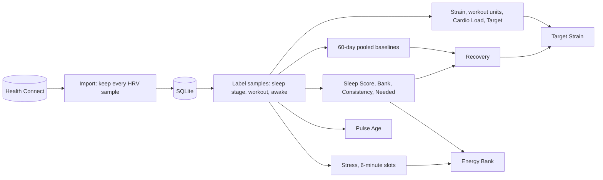

# Pulse engine: plan

Status: Phases 0 to 8 in code on branch `engine` (2026-10-14, SCORING_VERSION 24, IMPORT_VERSION 4). Left: try it on the phone (Phase 3 step 4), then fast-forward main and release 0.3.0. Written so a fresh Claude Code session can start at Phase 0 and
work through the phases in order, one or two per session.

## What and why

Pulse Mobile scores with halo's engine (scoring version 19), a mix of WHOOP-aligned guesses and ports from noop. The
web app (pulse, scoring version 10) scores with its own older engine, so the two apps disagree on the same night. The
owner decided on 2026-10-14 to replace both with one engine, built first in Pulse Mobile and copied to the web app later.

The new engine is **the Pulse engine** (scoring version 20). Its algorithms come from the reference study at
`~/personal/pulse/docs/research/bevel/`: a full reverse-engineering record of one wearable app's metric kernels, with
inputs, windows, constants, gates and presentation. Start every family from `pulse-gaps.md` there, then the family doc.

Naming rule: code, comments, UI copy, commit messages and docs call it the Pulse engine. They never name the app the
study describes. Code comments cite the study as "reference study, `<doc>.md` § `<section>`".

## Decisions already made (owner, 2026-10-14)

| Topic | Decision |
|---|---|
| Scope | Pulse Mobile first. The web app follows once the engine has run on the owner's phone for a while. |
| Name | The Pulse engine. Never named after the source app anywhere. |
| Strain scale | A percent, 0 to 100 on normal days, open-ended up to 128.8 (`16·atan(steps/7000) + 66·atan(U/20000)`). The ring fills to a full turn at 100 and stays full above it; the label shows the real value, so a huge day reads 112 %. The 0 to 21 scale goes. |
| Source quirks | Fix them; do not copy them. The list and each fix are in [Fixes to the source](#fixes-to-the-source). |
| Families left out | Food Glucose, Food Quality, Daily Nutrition, TDEE, blood panel (PhenoAge), cycle prediction: Health Connect has no data for them on the owner's Fitbit. |
| SpO2 | Absent. Fitbit does not write it to Health Connect (checked on the owner's phone). Recovery's SpO2 adjustment is optional in the source and simply drops out. |

## What Health Connect gives us (checked on the owner's phone, 2026-10-14)

Written by the Google Health app from a Fitbit Air:

- **HRV**: an RMSSD sample every 5 minutes through the night, none in the daytime. Today the app keeps only the night's
  mean (`src/health/import.ts:829`); the engine needs every sample.
- **Heart rate** samples (`HrSample`, stored), **sleep sessions** with stage segments (`Session`, `Segment`),
  **exercise sessions** (`Exercise`), **steps** per minute, **resting heart rate**, **respiratory rate**,
  **skin temperature**, **VO2 max**, weight, height.
- **No** oxygen saturation, blood glucose, blood pressure or food logs.

So the overnight HRV feeds Recovery (the mean of the samples in the main sleep, by stage) and Stress during sleep (each
6-minute slot takes the sample in or nearest before it). In the daytime, Stress runs on the source's heart-rate-only
path, and Energy Bank on that Stress.

## Fixes to the source

The study lists 18 behaviours that look like bugs or quirks (`pulse-gaps.md` § Decisions for the user). The owner
chose to fix them. Each fix needs a test that fails on the source behaviour.

| # | Source behaviour | The Pulse engine |
|---|---|---|
| 1 | EPOC grows while heart rate is below resting (wrong sign) | Decays at the same rate instead |
| 2 | Strain open-ended, ring overdraws | As in the decisions table: ring capped at a full turn, label shows the value |
| 3 | Energy Bank starts at 0 (shown as 1) on a fresh install, never resets | Warm up: run the state machine over the 7 days before the first scored day, then carry on continuously |
| 4 | Cycle variability defaults age to 40 | Not ported (cycle left out) |
| 5 | Blood panel row order depends on SQLite | Not ported (blood left out) |
| 6 | Three different rounding rules on screen | One rule everywhere: half away from zero |
| 7 | Missing sleep goal reads 7.5 h | Keep 7.5 h as the default, but read the goal from the profile (Settings › Goals) when set. Onboarding saves the study's age default (automatic). The automatic estimate ranks stored Recovery with the Sleep Score taken as 100 (value + 30 × (1 − sleepPerf)); a new goal replays the history |
| 8 | Recovery clamps to [1, 100] | Keep: not a bug |
| 9 | Biological Age does not renormalize missing factors | Renormalize over the factors present, with a minimum of 5 factors before a value is shown |
| 10 | Temperature = default baseline (97.9/98.1/95.7 F) + deviation; a baseline change shifts history | Use Health Connect's skin temperature delta against our own 60-day baseline; no default baseline |
| 11 | Energy data ignored by TDEE | Not ported (TDEE left out) |
| 12 | Sleep segment sort is not a strict ordering | Sort by start, then end, then stage |
| 13 | Two sessions with the same start can both be primary | The longer one is primary; ties go to the earlier end |
| 14 | Sleep Bank weights aligned from the oldest night | Align from the newest, so last night always weighs 1 |
| 15 | Stress and Energy Bank slots on a UTC-midnight grid | Local-midnight grid in the profile's time zone |
| 16 | TRIMP summed in dictionary order (Float32) | Sum in time order, in doubles |
| 17 | Calibration badges never change the score | Show the score from the first day it can be computed, marked `provisional` (honest states) until the calibration span is met: Recovery 60 days with 5 data days, Stress 30 days |
| 18 | Float32 arithmetic | Doubles throughout |

## Phases

Each phase ends with `pnpm typecheck && pnpm lint && pnpm test` green, a commit, and (from Phase 3) an APK on the
owner's phone. Every phase that changes what the pipeline stores bumps `SCORING_VERSION` (`src/pipeline/types.ts`):
20 in Phase 3, then 21, 22 and so on. Stage 1 reuses stored rows whose version matches (`stage1.ts:123`), so a phase
that changed scores without a bump would leave stale rows.

### Phase 0: read and set up (short)

1. Read `AGENTS.md`, this plan, and from the study: `README.md`, `pulse-gaps.md`, `shared-machinery.md`.
2. Read the current engine's entry points: `src/pipeline/index.ts`, `stage1.ts`, `stage2.ts`, `scores.ts`, and
   `src/core/scoring/recovery.ts` as an example of the file style.
3. Create `src/core/engine/` for the new kernels: one file per family, each with a test file beside it. The old
   `src/core/scoring` and `src/core/algorithms` files stay until Phase 8 so the app keeps working between phases.
4. Update `AGENTS.md`: halo is no longer the reference for `src/core/engine`; the reference study is.

### Phase 1: data (import and storage)

Goal: the engine's inputs exist in the store.

1. **HRV samples.** A new `HrvSample = { ts, ms }` table: `Store.putHrv` / `readHrv(lo, hi)` in `src/data/store.ts`,
   the SQLite store and `MemoryStore`, and a migration. Import keeps every `HeartRateVariabilityRmssd` record. Keep the
   nightly mean on `Metrics.hrvMs` for the screens that show it. Bump `IMPORT_VERSION` (`src/health/sync.ts`) to 4 so
   the 180-day history is re-imported with samples.
2. **Sample labelling** (`src/core/engine/context.ts`): a pure function that gives any timestamp its context from the
   day's sessions, segments and exercises, with the study's precedence (workout over exercise over sleep over awake)
   and its `[start, end)` rule. Sleep splits into `remAndDeepSleep` and `otherSleep`.
3. **Minute heart rate**: per-minute mean from `HrSample` (derived on read, not stored), labelled by context.
4. **Workout heart-rate segments** for TRIMP: the heart-rate samples inside each exercise window.
5. Demo seed (`src/data/seed.ts`): generate HRV samples every 5 minutes through each seeded night, so tests have them.

Tests: the labelling precedence and boundaries; a night's samples land in the right stages; the import keeps every
sample; MemoryStore and SQLite store agree.

### Phase 2: shared machinery

From `shared-machinery.md`: functional days (a night belongs to the day it ends), window types, the **60-day pooled
baselines** (mean, SD and histograms over prior days only, never the scored day: causality), settings and defaults
(sleep goal from the profile, zone settings with max HR 195 default and the profile's age), and the gates as honest
states (fix 17). File: `src/core/engine/baselines.ts`, `days.ts`.

### Phase 3: sleep family, then Recovery (first release of the engine)

Order matters: Recovery takes the Sleep Score.

1. `sleep.md`: Sleep Score (six components, exponents and weights, targets by age and sex, missing components dropped
   and renormalized), HR dip against the awake-HR baseline, Sleep Bank (fix 14), Sleep Consistency (1440-bin agreement
   over up to 7 nights, local midnight), Sleep Needed and the tonight planner.
2. `recovery-stress-energy.md` § Recovery: `0.4·HRV + 0.3·RHR + 0.3·Sleep`, then the respiratory-rate and temperature
   adjustments (SpO2 drops out), clamp [1, 100]. HRV = mean of the night's samples tagged `remAndDeepSleep` or
   `otherSleep` in the main sleep; RHR = mean heart rate in the same contexts; baselines from Phase 2.
3. Wire both into stage 2 (`src/pipeline/stage2.ts`, `scores.ts`), bump `SCORING_VERSION` to 20, and adapt the view
   models in `src/queries` that read the changed fields. Screens keep their look (AGENTS.md: adapt the code, not the
   look).
4. Build an APK with the same EAS key (`docs/releases.md`, memory: never swap to a debug-signed build) and put it on
   the owner's phone. The owner compares Recovery with Google Health's readiness for a few days before Phase 4.

Tests: golden values worked by hand from the formulas in the study for a few constructed nights; property tests
(more HRV never lowers Recovery, a later night never changes an earlier score).

### Phase 4: strain family

`strain-load.md`: workout units (cardio from the zone-weight table `(0,1)(2,2)(3,4)(4,7)(7,12)(12,20)` interpolated,
muscular for strength types), TRIMP (fix 16), Daily Strain with awake steps, Cardio Load (ATL 0.25, CTL 2/43, zero
seed), Target Strain (fold `B·0.75 + v·0.25`, recovery factor, bounds), heart-rate recovery after workouts, EPOC
(fix 1). UI: the strain ring and every strain chart move to the percent scale (decision above): `src/ui` dials,
`StrainRecoveryChart`, Strain screen, Home dials, Trends. Copy says "Strain 42 %".

### Phase 5: Stress and Energy Bank

`recovery-stress-energy.md` § Stress and § Energy Bank: 6-minute slots on the local grid (fix 15), per-slot heart
rate (median under 8 samples, else 15 % trimmed mean, gap fill), the 30-day awake heart-rate percentile mapped to 0 to
100, the HRV term during sleep from the 5-minute samples, the context filter. Energy Bank: the charge and drain state
machine on 360-second slots, clamp [1, 100], continuous across midnight with the warm-up (fix 3). The Energy Bank card
and Stress chart keep their look; check their axes for the new ranges.

### Phase 6: Pulse Age and Muscular Load

`biological-age-muscular.md`: the nine hazard terms over 28-day windows (fix 9), VO2 max and lean percentage from
Health Connect. Muscular Load and Freshness: the cardio-derived part only (Health Connect has no per-set data).

### Phase 7: the rest that the screens use

Health Monitor bands (`other-calculators.md`: normal within ±1 SD of the viewed window), journal insight (OLS slope
and pooled t-test over 90 days, at least 5 values per group). Anything a screen shows that no phase above replaced:
list it here before starting.

Done 2026-10-14: Health Monitor's band is ±1 SD of the last 30 nights (the night shown included; the study used the
trend window on screen, and 30 nights is the Health Monitor's), and journal impact is the pooled t-test with its 70 %
interval (delta ± t85 · SE) in place of halo's bootstrap.

What screens still show from halo's code, with no counterpart in the reference study, kept as Pulse's own extras on
the engine's inputs (they read the engine's Recovery, Sleep Score and strain where they read a score):

| Screen value | Code | Reads |
|---|---|---|
| HRV Status (7-day average against a band) | `core/algorithms/hrvStatus.ts` | the engine's night HRV |
| Training: Training Effect, Recovery Time, Training Readiness, Training Status | `core/algorithms/trainingEffect.ts`, `trainingReadiness.ts`, `trainingStatus.ts` | engine Recovery and Sleep Score; halo's 0–3 stress internally |
| VO2 max category and Fitness Age | `core/algorithms/fitnessLevel.ts` | Fitbit's VO2 max |
| Recovery forecast | `core/scoring/forecast.ts` | engine Recovery history |
| Tonight's bedtimes | `core/algorithms/sleepPlanner.ts` | the engine's tonight need |
| Illness signal in Health Monitor | `core/scoring/illness.ts` | the engine's vitals |
| Activity Cost, reports, streaks, detected activities | `core/algorithms/activityCost.ts`, `reports.ts`, `streaks.ts`, `autoWorkout.ts` | engine Recovery, strain |
| Muscular Load and Freshness | not ported | needs per-set strength data Health Connect does not have |

### Phase 8: clean up and release

Delete the replaced files in `src/core/scoring` and `src/core/algorithms` and their tests; update `docs/learning.md`,
`docs/design/spec.md` (strain percent, any copy), the metric info sheets, and `AGENTS.md`. Release 0.3.0
(`docs/releases.md`), then plan the web app port.

## Rules for every session

- AGENTS.md applies: no I/O in `src/core`, only `src/data` touches SQLite, honest states, causality, long loops await
  `slice()`, tests on `MemoryStore` over the demo seed.
- The `Store` interface changes only in the orchestrating session (Phase 1 is that change).
- Lean subagents: targeted reads, checks once, short reports.
- Try each phase on the owner's phone (same-key APK, `adb install -r`, data kept) before pushing to `main`.

## Risks

- The study was never compared with the source app's live numbers, so the engine is a faithful reading of the code,
  not a verified match.
- Fitbit data reaches Health Connect through the Google Health app, which may choose fields differently from the
  source app's own Google integration; numbers can differ from the source app even with a perfect port.
- The algorithms come from decompiled code. The owner accepted this risk on 2026-10-14.
