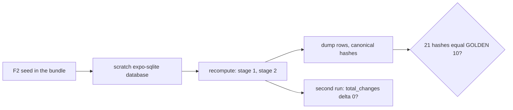

# Score parity on the phone (F3 under Hermes)

The Node tests prove the pipeline reproduces pulse's scores (fixture F3, all 21 hashes) on the SQLite repositories.
The phone runs a different JavaScript engine (Hermes) and a different SQLite driver (expo-sqlite), so this screen runs
the same check on the device: it loads the F2 seed into a scratch database, recomputes every day, compares the 21 hashes
with pulse's `GOLDEN[10]`, then runs again and expects zero writes. The scratch database is deleted afterwards; the app's
own database is not touched.

## Run it

1. On the Mac: `npx expo start --go` (Expo Go) or `npx expo start` (development build), and open the app.
2. Open the route `/dev/parity`: in Expo Go, open `exp://<the address under the QR code>/--/dev/parity`; in a
   development build, `pulse://dev/parity`. The same ways as `docs/hermes-time-check.md`.
3. Tap Run. It takes a while: loading 180 days and scoring them on a phone is tens of seconds.

**Pass:** "PASS: 21 of 21 hashes equal", "Second run wrote 0 rows", the header says Hermes.
**Fail:** send a screenshot, or the line starting `PARITY` from the Metro terminal. Each differing key shows both
hashes. A difference here and not in Node means Hermes math or ordering differs (the plan's risk 2); the comparison rule
(10 significant digits) is not loosened to hide it.

## Before a store build

The `/dev` routes bundle their fixtures (the F2 seed is 10 MB of JSON), which roughly doubles the app bundle. They must
be left out of release builds (release stream M).
