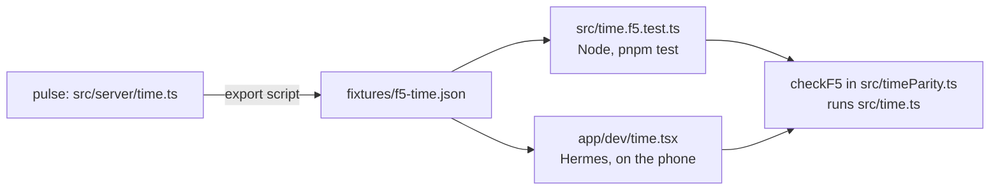

# Checking time.ts under Hermes on your phone

`src/time.ts` is pulse's `src/server/time.ts`, byte for byte. Every local day, midnight and wall time in Pulse comes from
it, and it leans on `Intl.DateTimeFormat` with a `timeZone`. Node (where `pnpm test` runs) ships one Intl
implementation; your phone runs Hermes, whose Intl is backed by the operating system (ICU through Java on Android,
Foundation on iOS). This check runs the F5 fixture, exported from pulse, through `time.ts` on the phone and shows
whether every case agrees.

`pnpm test` runs the same check under Node (`src/time.f5.test.ts`); both call `checkF5` in `src/timeParity.ts`.

## Concepts used here

- **Hermes**: the JavaScript engine React Native runs your code on, instead of V8 (Node, Chrome). Same language,
  different implementation, so built-ins like `Intl` can behave differently. Expo Go and development builds both use it.
- **Metro**: the bundler. `npx expo start` starts it on your Mac; the app on the phone downloads the JavaScript bundle
  from it over Wi-Fi and reloads when files change.
- **Expo Go**: a ready-made app from Expo that contains a fixed set of native modules. It can run any project that only
  uses those modules, with no build step. One Expo Go version supports one SDK.
- **Development build**: your own app binary (`in.portlabs.pulse`) with the `expo-dev-client` launcher inside. You build
  it once with EAS (Expo's cloud build service); after that it loads JavaScript from Metro like Expo Go does. You need
  one when the app uses native code Expo Go does not ship.
- **Expo Router route**: every file under `app/` is a screen, addressed by its path. `app/dev/time.tsx` is the screen at
  `/dev/time`. Nothing in the app links to it; you open it with a deep link.
- **Deep link**: a URL that opens an app at a screen. In Expo Go it is `exp://<mac-ip>:8081/--/dev/time` (Expo Go puts
  `/--/` before the route). In the development build it is `pulse://dev/time` (`scheme` is `pulse` in `app.json`).
- **NativeWind `className`**: Tailwind classes on React Native's `View` and `Text`, turned into native styles. The
  screen uses it only for layout and colours.

## Before you start

- The branch you run must contain `fixtures/f5-time.json` (exported from pulse by the parity fixture script). Without it,
  Metro fails to bundle with "Unable to resolve ../../fixtures/f5-time.json".
- `pnpm install` done, Mac and phone on the same Wi-Fi.
- Run both Android and iOS if you can: their Intl implementations differ.

## Option 1: Expo Go (no build)

The app needs nothing Expo Go lacks today. Checked against `package.json` on SDK 57: the code imports only `expo-router`,
`expo-sqlite`, `react-native` and JavaScript packages (drizzle, NativeWind), and the installed native packages
(`expo-sqlite`, `expo-secure-store`, `expo-symbols`, `expo-glass-effect`, `@expo/ui`, `react-native-reanimated` and its
`react-native-worklets`, gesture handler, screens, safe area) are all marked "Included in Expo Go" in the SDK 57 docs.
`expo-dev-client` is installed too; Expo Go ignores it, but it makes `npx expo start` target a development build by
default, hence `--go` below.

Getting an SDK 57 Expo Go onto the phone:

- **Android**: open https://expo.dev/go on the phone, pick SDK 57 and Android, install that build (the Play Store version
  can lag behind a new SDK).
- **iPhone**: the App Store Expo Go stops at SDK 54. For SDK 57 you build your own Expo Go with `npx eas-cli@latest go`,
  which goes out through TestFlight and needs an Apple Developer Program membership. If you are doing that anyway,
  Option 2 is about the same effort.

Then:

1. On the Mac, in the repo: `npx expo start --go`. Note the `exp://192.168.x.x:8081` address printed under the QR code.
2. Make a QR code for the route, with that address: `pnpm dlx qrcode "exp://192.168.x.x:8081/--/dev/time"` (prints the
   code in the terminal).
3. Scan it: Android with the scanner in Expo Go, iPhone with the Camera app. Expo Go opens the project straight on the
   check screen. On Android over USB you can skip the QR:
   `adb shell am start -a android.intent.action.VIEW -d "exp://192.168.x.x:8081/--/dev/time"`.
4. Wait for "Running…" to change (a few seconds; tens of thousands of cases).

## Option 2: development build (EAS)

`eas.json` already has a `development` profile (`developmentClient: true`, `distribution: internal`).

1. `npx eas-cli@latest login` (Expo account).
2. iPhone only: `npx eas-cli@latest device:create` and follow the link on the phone to register it; then on the phone
   turn on Settings > Privacy & Security > Developer Mode once the build is installed (iOS asks for a restart).
   A paid Apple Developer account is required for device builds.
3. Build: `npx eas-cli@latest build --profile development --platform android` (or `--platform ios`). The first run
   offers to create the EAS project and writes its id into `app.json`; commit that change.
4. Install: when the build finishes, scan the QR code the CLI prints (or open the build page on expo.dev from the phone).
   Android installs an APK (allow the "unknown app" prompt); iOS installs only on registered devices.
5. `npx expo start` (it targets the development build because `expo-dev-client` is installed). Scan its QR code with the
   phone camera; the Pulse build opens and loads the bundle.
6. With the app open and connected, open the route: make a QR with `pnpm dlx qrcode "pulse://dev/time"` and scan it, or
   on Android over USB run `adb shell am start -a android.intent.action.VIEW -d "pulse://dev/time"`.

Rebuild only when native code changes (a new native package or a config plugin change); JavaScript changes, including
a new fixture, reload from Metro.

## What you should see

Passing:

- Title "F5 time check", then "Hermes · fixture from pulse <commit sha>". If it says "not Hermes", tell me: the app is
  not running on Hermes and the check proves nothing.
- A green line "PASS: N of N" and the run time in ms.

Failing: a red "FAIL: k of N", then up to 20 cases, each as the function, its input, the expected value (pulse under
Node) and what Hermes returned. A value like `"threw RangeError: ..."` means Intl rejected the time zone.

## What to send back when it fails

1. A screenshot of the screen (the case text is selectable, so you can also copy it).
2. The line starting `F5 {"total":...` that the screen logs: it is in the `npx expo start` terminal, or press `j` there
   to open React Native DevTools and copy it from the Console. It holds the totals and the first 20 failures as JSON.
3. Phone model, Android or iOS version, and Expo Go or development build.
4. The fixture's `generatedFrom` line (shown under the title).
