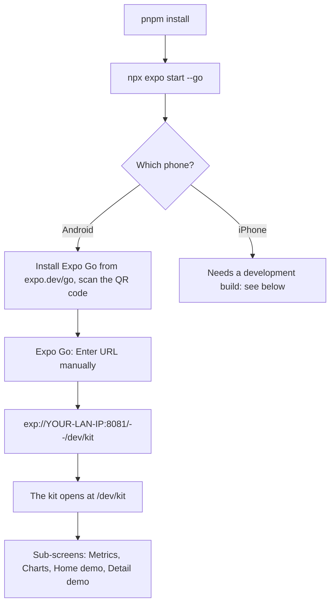

# Checking the UI kit on your phone

The kit screen shows every shell, metric component and chart with the same sample props as the web app's kit page (`/dev/kit` in the pulse repo), so you can put the phone next to the web page and compare. Nothing here needs a Google account or any data: it all runs on fixtures.

## Open it

1. In a terminal in this repository: `pnpm install`, then `npx expo start --go`. The `--go` flag is needed because `expo-dev-client` is installed, which otherwise makes `expo start` serve a development build.
2. Phone and computer must be on the same Wi-Fi. Android: install **Expo Go** from <https://expo.dev/go> (the Play Store build may lag behind SDK 57) and scan the QR code the terminal prints. The app opens on the Home tab (still the scaffold screen).
3. The tab screens have no link to the kit. In Expo Go choose **Enter URL manually** and type `exp://<your computer's LAN IP>:8081/--/dev/kit` (the IP is in the terminal under the QR code). Fallback: `exp://<ip>:8081/--/_sitemap` lists every route; tap `dev/kit`.
4. The kit's first screen has the light / dark toggle (System, Light, Dark). It is global: the Home and Detail demos, which have no toggle, follow the last choice. Pull down the Expo Go menu (shake) and tap Reload if a screen looks stale.

**Expo Go is enough on Android.** Skia, Reanimated, gesture handler, SVG and the fonts are all bundled in Expo Go for SDK 57; everything else is JavaScript. If something does not render, the fallback is a development build, which carries the exact native modules of this project.

**iPhone** (the App Store's Expo Go stops at SDK 54): build a development client with `npx eas-cli@latest build --profile development --platform ios`, install it, run `npx expo start` (no `--go`), and open `pulse://dev/kit`. The same development build works for Android: `--platform android`, or `pnpm android` with the phone on USB.

## Open the web kit beside it

In the pulse repository (read-only reference at `/Users/adityajindal/personal/worktrees/pulse/reference`): `pnpm dev`, then open `http://localhost:3000/dev/kit` in a browser at about 390 px wide (devtools device mode, iPhone 14). The web page lists each component as an entry with frames; the phone kit uses the same entry and frame names, in the same order.

## What to compare, per component

Check each frame in light and in dark. "Same" means the same number, copy, colour, order and rough spacing; a few pixels of difference in text metrics is expected (the phone uses the same Figtree and Barlow files, but React Native lays text out differently from a browser).

| Component | Compare |
|---|---|
| Colour tokens | Every swatch against the web's `globals.css` value in both themes; the card on the ground; the dials' track. |
| Type | Figtree body and Barlow numerals; tabular figures (the digits of `0123456789` are equal width); the 12 px caps labels with their letter spacing. |
| Wordmark, Mark | Shapes and sizes; the wordmark's heartbeat in the L. |
| Button, Segmented, Tag, StatusChip, DeltaMark, ValueUnit | Heights (44 / 56 px), radii, the selected segment, tag capitals, chip icon and tone colours, triangle direction and tone, unit weight and gap. |
| SectionShell | Section title 22 px, card title caps, the chevron on a whole-card link, the info button, "View all" link. |
| CollapsibleSection, EmptyState, MetricState | The chevron turns; the five states (loading, empty, reason, provisional, value) in one list; each reason code's icon and copy. |
| DateSwitcher, CalendarPanel | Pill sizes and labels ("Today", "Yesterday", "Mon., Sep. 28"); steppers grey out at today; the calendar drops from the top, colours Recovery days, shows a dashed ring on today and the legend; the week pill. |
| InfoButton, LinkList, ResponsiveSheet | The centred info card (title caps, chip, outline action); 56 px link rows; the bottom sheet: handle, centred caps title, X at the right, pill footer; the tall and full-screen sizes. |
| ScoreDial | The 4 degree gap at 12 o'clock; band colours (green 67+, yellow 34 to 66, red below); the Strain Target band and white tick; the stress gauge's gradient arc and needle; every reason code in the large ring; tags stack; compact form; loading; arc thickness against the web at each size. |
| MiniRing | Track and fill at 0, mid, max; no value. |
| KeyStatRow | Row, card and tile: label caps, value and unit, the average under the value, arrow direction and tone, the status segments, chips, tags, the wide tile with a sparkline, reasons, loading. |
| ContributorRow | The shaded normal range, the dot position and colour, points in green/orange, the Healthspan ten-segment bar, its two markers and the years column. |
| DriverList, TickScale, DayStrip | Diverging bars on the hatched track, sort order, "Hurts / Helps" header; 48 ticks, the lit tick, bands, end labels; 30 days, selected day centred, recovery bar colour, the journal's check badge and pill form. |
| InsightCard, ActivityCard, SleepCard, SleepStages | The gradient hairline; the 84 px chip, name, times and bar; the hours hero, the stages' radio rows, typical-range boxes, the Breakdown / Timeline tabs. |
| BreakdownBar, TrendLegend, Sparkline | Proportions, swatch shapes, the dashed band. |
| TrendChart | W, M and 6M: bars, value labels in W, the average line and pill, the shaded band, the dashed target, the 6M gradient line; the header changes while you drag; the range chip; stacked and smooth variants. |
| ColumnChart, Hypnogram, IntradayHrChart, SleepHrChart | Column track and highlight, reference line pill; the four lanes in stage colours with bold bed and wake times; zone strips (Z1 to Z5), span headers and the "now" line; the low-point pill and bed/wake markers; the lit stage on the night's heart rate. |
| StressChart, EnergyBankChart, StrainRecoveryChart | Level-coloured line and area; drain pills and the nap span; two-axis week, today's lit column, label placement away from the lines. |
| ZoneBars | Row order (zone 5 first), the share in the zone's colour, hatched track, typical-range box; the stacked bar. |
| Home demo | The top row (avatar, date pill), the dials and the ring row that eases in once the dials have scrolled away. |
| Detail demo | The date as the header title; the hero ring; after scrolling, the hero shrinks into the header with the two stats. |
| Tab bar (tab screens) | The floating glass bar, the sliding lens under the active tab, the round "P" action beside it. |

Touch checks: drag across a chart (a cursor and a tooltip; a vertical swipe still scrolls the page); tap a bar; tap a sheet's dim to close it; the Android back gesture closes the calendar, the info card and sheets.

## Differences you will see, on purpose

- No blur on the glass bar and sheets (the blur module is not installed); the glass is its solid fallback colour. Cards are a flat colour, without the web's 2 to 4 percent top-to-bottom fade.
- Charts are Skia, not SVG in the DOM: curves match (Recharts' monotone curve is reimplemented), but anti-aliasing differs a little. Hover tooltips are touch tooltips.
- The Home header shows the ring row with a fade (the web's laptop behaviour) instead of morphing each dial into its ring on scroll.
- The tablet rail and laptop sidebar, two-column layouts and keyboard shortcuts of the web are not ported (phone only).
- `?d=` is the route parameter `d`; the trend range is the chart's own state, not `?r=`.

## Not in the kit yet

AgeOrb, ConnectionBanner, the sync status control, TrendViewChart and the walkthrough and brand icons (BandIcon, Google marks) are not ported: each depends on data, sync or accounts that belong to other streams.
