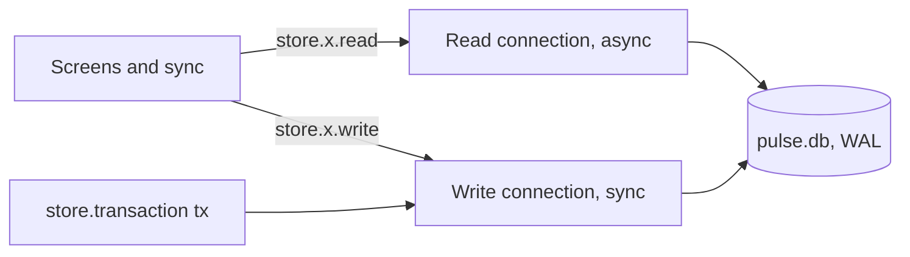
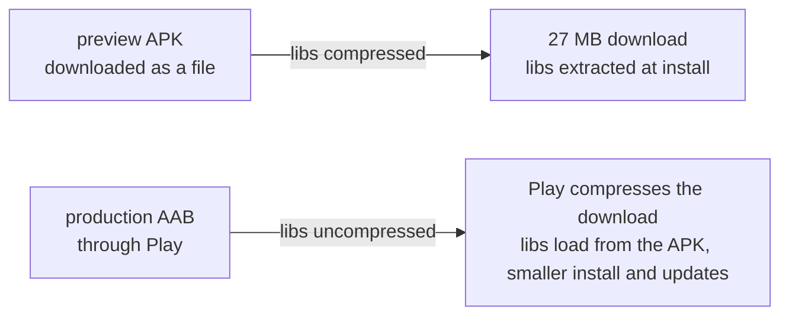
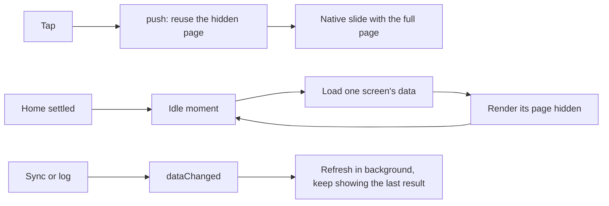
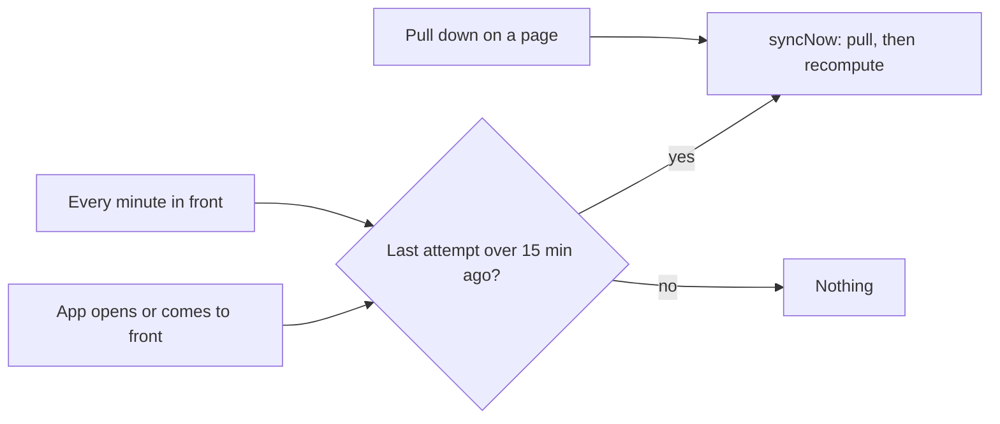

# Learning notes

A running notebook for learning React Native through this project. One short section per choice: what it is, and why it was chosen here. Add a section whenever an Expo or React Native choice is made.

## Expo instead of bare React Native

Expo is a toolkit on top of React Native: one config file, ready-made native modules, cloud builds. Here it is SDK 57 with React Native 0.86. Bare React Native would mean hand-managing Xcode and Gradle projects for no gain.

## Continuous Native Generation

The `ios/` and `android/` folders are not in git. Expo generates them from `app.json` and its plugins, and `.gitignore` lists them. Never edit them by hand: change `app.json` or a config plugin instead, and the folders are rebuilt.

## Expo Router

File-based routes in `app/`, like Next's App Router. A file is a screen, and `_layout.tsx` is the navigator around its folder (the root one wraps the whole app in a `Stack`). Routes live in the root `app/`, not in `src/`, so `src/` holds only non-route code.

## Hermes

Hermes is the JavaScript engine React Native runs, instead of V8 (Node, Chrome). Its `Intl` and some math functions can differ from Node in small ways. That is why the time code and the scoring code are checked under Hermes, not only in Node.

## Metro

Metro is React Native's bundler (the counterpart of webpack or Turbopack). `metro.config.js` adds `.sql` as a source extension, so drizzle's migration files can be imported, and wraps the config in NativeWind's `withNativeWind`, pointing at `global.css`.

## Babel config

`babel.config.js` has two non-default parts. `jsxImportSource: "nativewind"` plus `nativewind/babel` make the `className` prop work on React Native views. `babel-plugin-inline-import` turns `.sql` imports into strings, so the migration files are bundled into the app.

## NativeWind 4 with Tailwind 3

NativeWind lets you put Tailwind classes on React Native views with `className`. It is version 4 on Tailwind 3 because version 5 is still a release candidate. `react-native-css-interop` is a direct dependency because pnpm's strict layout only lets a package see what it declares, and NativeWind's Babel preset needs to resolve it from the project root.

## React Compiler

`app.json` sets `experiments.reactCompiler`. The compiler memoizes components for you, so there is no hand-written `useMemo` or `useCallback` to keep render cost down. `experiments.typedRoutes` types route paths for `Link` and `router`.

## expo-sqlite with drizzle

`expo-sqlite` is the on-device database; drizzle is the same ORM the web app uses, so the repositories read almost the same. Migrations are SQL files generated by `pnpm db:generate` and bundled into the app. They run at app start through `useMigrations` in the root layout (`app/_layout.tsx`), which shows nothing until they finish, so no screen sees a half-migrated database.

## expo-secure-store

Stores small secrets in the iOS Keychain and the Android Keystore. The Google refresh token and the coach's provider key live there and nowhere else: not in SQLite, not in logs.

## Expo Go versus a development build

Expo Go is a prebuilt app that runs your JavaScript, but only with the native modules it ships. A development build (`expo-dev-client`) is your own app binary with your native modules in it, still loading JavaScript from the dev server. Use Expo Go while the app needs nothing extra; move to a development build when a native module is not in Expo Go.

## EAS build profiles

`eas.json` has three. `development` builds a development client for internal distribution (installs on your own phone). `preview` is an internal-distribution build of the release app, for testing it as users get it. `production` is the store build, and `autoIncrement` bumps the build number each time. `appVersionSource: "remote"` keeps the version counter on Expo's servers.

## `npx expo install` instead of `pnpm add`

`npx expo install <pkg>` picks the version that matches the Expo SDK, then installs it with the project's package manager (pnpm here). `pnpm add` would take the latest version, which can break against the SDK's React Native.

## Bundle id and Android package `in.portlabs.pulse`

Both come from the owner's domain, portlabs.in, written in reverse. They are hard to change after a store release, and the Google OAuth clients are tied to them, so they were fixed before anything shipped.

## Vitest with better-sqlite3

Tests run in Node, not on a phone. `better-sqlite3` is a Node SQLite binding, and drizzle has an adapter for it, so repository and migration tests run the real SQL quickly and in CI. The device itself is checked by hand.

## `expo start --go`

Once `expo-dev-client` is installed, `npx expo start` serves a development build by default. Add `--go` to open the
project in Expo Go instead. On iPhone, the App Store's Expo Go stops at SDK 54, so this SDK 57 app needs `eas go`
(TestFlight) or a development build; on Android, Expo Go for SDK 57 comes from expo.dev/go.

## SQLite foreign keys

SQLite turns foreign keys off for every new connection. `src/data/db.ts` runs `PRAGMA foreign_keys = ON` right after
opening the database, so deleting a sleep session also deletes its segments.

## `fetch` on React Native

The Google client uses the global `fetch`, as Node does, but React Native's `AbortSignal` has no `AbortSignal.timeout()`. The client makes an `AbortController` and a 30 s timer per request instead, and clears the timer in a `finally`. `res.body` can be missing on React Native, so the client only calls `res.body?.cancel()`.

## Ids without `node:crypto`

Pulse made log-entry ids with node's `randomUUID`. Hermes has `crypto.randomUUID` only when a polyfill adds it, so `src/google/log.ts` uses it when present and otherwise builds a version 4 shaped id from `Math.random`. The ids are local keys, not secrets; callers can inject a better `newId`.

## Repositories run on a synchronous drizzle database

The repositories take one `Db` type (drizzle's synchronous SQLite database). `expo-sqlite` runs under it in the app and `better-sqlite3` in Node tests, so the same code is tested in Node and shipped to the phone. Each method is `async` to keep the interface the pipeline already expects. Writes, and the reads a write depends on, run synchronously: that makes a multi-statement method atomic inside the one JS thread. `src/data/testing.ts` opens an in-memory database with the migrations applied.

## Reads on a second, asynchronous connection

A synchronous read holds the JS thread while SQLite works, so a screen's query stopped taps and animations. `src/data/db.ts` opens the file twice: the write connection (synchronous, as above) and a read connection that drizzle reaches through `drizzle-orm/sqlite-proxy`, whose callback calls expo-sqlite's async API (`prepareAsync`, `executeForRawResultAsync`), which runs the query on a background thread. The file is in WAL mode, so the reader never waits for the writer and sees committed data only.

Each repository takes both handles (`xRepo(db, read)`) and sends pure reads to `read`. The store's own repositories read on the read connection; the repositories a transaction hands out (`tx`) read and write on the write connection, so a transaction sees its own uncommitted rows. In tests both handles are the one better-sqlite3 database, and `src/data/repos/store.test.ts` also runs the app's two-connection setup on a WAL file.



## `loadDays` keeps recent ranges in memory

Most screens ask for the same 30 to 180 days of `daily_scores` and `daily_metrics`, and parsing those JSON columns was most of a query's time. `loadDays` (`src/queries/common.ts`) keeps its last 16 ranges per store and drops them all when `store.dataVersion()` changes. That value is SQLite's `data_version` (bumped when another connection commits) joined with `total_changes()` (this connection's own writes), read on the read connection, so any write, from any path, invalidates the cache. Callers must treat the rows as read-only.

## One write connection, a queue and savepoints

All writes go through one SQLite connection, and drizzle's `db.transaction` cannot take an async callback on it. `Store.transaction` sends `BEGIN IMMEDIATE`, awaits your callback, then `COMMIT` or `ROLLBACK`, and starts the next transaction only when the last has ended. Methods that need several statements to land together use a `SAVEPOINT` instead, which works alone and nested inside a transaction.

## Sample BLOBs

A day of heart rate is about 37,000 samples. Pulse kept them as Postgres arrays; here they are two BLOBs: second offsets as delta-encoded varints (a gap under 128 s is one byte) and bpm as one byte each, about 74 KB a day. Steps per minute can exceed 255, so their values are varints too. A `BLOB` is a `Uint8Array` in React Native (there is no Node `Buffer`).

## "Write nothing when unchanged" without `IS DISTINCT FROM`

SQLite has no `IS DISTINCT FROM`, but `IS NOT` compares null-safely. A repeat sync uses `INSERT ... ON CONFLICT DO UPDATE ... WHERE col IS NOT excluded.col`, so an unchanged row is not written (SQLite's `total_changes()` stays put, which the tests assert). JSON columns are compared as their text.

## SHA-1 and text order on Hermes

Hermes has no `node:crypto`, so the pipeline's stage-1 and journal-impact keys use `sha1` from `@noble/hashes/legacy.js` (pure JS, same hex; `src/pipeline/data.test.ts` checks it against Node).
`localeCompare` follows the platform's collation (Hermes differs from V8), so the pipeline sorts ids with `byteCompare` (the database's "C" order); the same test proves both orders agree on every fixture id. `src/core` still calls `localeCompare` on days and tags (reports.ts:103, journalImpact.ts:133): a fix belongs in pulse first.

## NativeWind tokens: CSS variables for light and dark

`global.css` holds every colour of the web's `globals.css` as a CSS variable, same names: `:root` is light and `.dark:root` is dark, because `tailwind.config.js` sets `darkMode: "class"` and NativeWind reads exactly those two selectors. `colorScheme.set("dark")` flips the class at runtime and every `bg-card` follows. A solid colour is stored as `R G B` channels so `bg-foreground/10` still works; `tailwind.config.js` reads `global.css` itself, so a token is added in one place.

## 1rem is 14 px in NativeWind

NativeWind turns `1rem` into 14 px (its `inlineRem` default), where the web means 16 px, so every Tailwind scale in rem would be 12% too small. `tailwind.config.js` restates spacing, radii, font sizes and line heights in px instead of changing the Metro config, so `p-4` is 16 px and `rounded-2xl` is 16 px, as on the web.

## Colours in Skia and SVG: `palette.ts`

Skia and react-native-svg draw with colour strings, not CSS variables. `src/ui/palette.ts` holds the same tokens as hex, `useTheme()` returns the palette of the active scheme, and a Vitest test (`palette.test.ts`) fails if `global.css` and the palette ever differ. `resolveCss("var(--strain)")` lets the ported code keep the web's `DATA_COLORS[..].css` strings.

## Fonts: one family name per weight

React Native picks a custom font by its exact name (`Barlow_700Bold`), not by family plus `fontWeight`. `app/_layout.tsx` loads seven files with `useFonts`, and `src/ui/Text.tsx` reads the web's `font-numeric font-bold` classes off `className`, drops them and sets `fontFamily`. Nested `<Text>` inherits the family and weight, as CSS does. The splash screen stays up until the fonts and the migrations are ready.

## Text colour does not inherit from a `View`

On the web `body` sets `text-foreground` and everything inherits it. In React Native only a parent `<Text>` passes its colour down, so `<Text>` adds `text-foreground` when a top-level text names no colour of its own. Icons take a `tone` (a token name) for the same reason: there is no `currentColor`.

## Root providers: gesture handler, safe area, bottom sheets

`src/ui/providers.tsx` wraps the app once. `GestureHandlerRootView` is required for any gesture (chart scrubbing); `SafeAreaProvider` gives headers the notch and home-indicator insets; `ShellCalendarProvider` carries today's date. Sheets need no provider any more: they are routes (see "Sheets are routes", below), and `@gorhom/bottom-sheet` is no longer used.

## The tab bar: Pulse's own glass bar

`app/(tabs)/_layout.tsx` uses Expo Router's `<Tabs>` with a custom `tabBar`: Pulse's floating glass bar from the web (`src/ui/shells/TabBar.tsx`), with the round check-in action beside it, identical on iOS and Android. Native tabs (the system bar: Liquid Glass on iOS 26, Material 3 on Android) were tried and dropped on 2026-10-11: the owner wants every screen to look as the Pulse PWA does. `<Tabs>` still gives the native behaviour that matters: each tab's screen stays alive, and the parentheses make `(tabs)` a route group (no URL segment, so Home stays `/`). Detail screens live outside the group, in the root `Stack`, so they cover the bar.

## Reanimated for header motion

Scroll position lives in a Reanimated shared value updated on the UI thread (`useAnimatedScrollHandler`); a derived value turns it into a 0 to 1 "collapsed" state and `useAnimatedStyle` maps that to opacity, scale and height. Nothing re-renders while scrolling. The headers are absolute views over the scroll view, with content padded under them.

## Plain Skia for charts, not victory-native

`victory-native` is a wrapper that draws standard cartesian charts; the web charts need band-coloured gradient lines, gaps that break a line, labelled drain pills and a hypnogram. Each chart here is one `<Canvas>` of Skia shapes, with the path maths in `src/ui/charts/geometry.ts` (pure functions, unit-tested in Node) and axis text as ordinary `<Text>` laid over the canvas, so text keeps the app's fonts, theme and accessibility.

## react-native-svg for rings, gradients and the hatch

The score dials, mini rings, wordmark, page ground, header fade and hatched tracks are small static drawings: react-native-svg is bundled in Expo Go and draws them with the same arc and gradient vocabulary the web used. Plain two-colour gradients (cards, the insight hairline, glass) are `expo-linear-gradient` instead, see "Native gradients and the card fill".

## The info card

Every "i" opens the web's centred card over a strong dim (`InfoDialog`), a React Native `<Modal>` with a fade: the OS back gesture closes it, and taps on the dim close it.

## Gestures: scrubbing a chart

The web shows a tooltip on hover. A phone has no hover, so `ScrubLayer` puts a gesture-handler pan (horizontal drag only, so a vertical swipe still scrolls the page) and a tap over the plot; the touched x becomes a cursor and a tooltip card. Tapping the pinned point again clears it.

## No `tailwind-merge`, no `class-variance-authority`

The web components lean on `twMerge` so a later class overrides an earlier one. NativeWind resolves two conflicting classes by stylesheet order, not class order, so the ports write each class once and `cn()` only joins strings.

## `boxShadow` style for card edges

React Native 0.86 on the new architecture takes a CSS-like `boxShadow` string, including `inset`. The card's top hairline (dark) and its 1 px ring with a soft shadow (light) are written that way, as the web writes `shadow-card`.

## `Pressable` with `active:` classes

`active:scale-[0.96]` works on a NativeWind-styled `Pressable`: it maps to the press state. Every pressable row, card and chip uses it for the web's pressed look. The OS back gesture, haptics and screen-reader roles (`accessibilityRole`, `accessibilityLabel`) replace the web's focus rings and `sr-only` text.

## Why the kit runs in Expo Go

Everything the kit uses (Skia, Reanimated, gesture handler, SVG, safe-area, expo-font) is bundled in Expo Go for SDK 57; NativeWind and the icons are plain JavaScript; form sheets, `expo-blur`, `expo-linear-gradient` and `expo-haptics` are in Expo Go too (haptics: the docs do not print the badge, so the checklist confirms it). So `npx expo start --go` is enough on Android. An iPhone needs a development build, since the App Store's Expo Go stops at SDK 54.

## Sheets are routes (`presentation: "formSheet"`)

A task sheet (check-in, logs, info) is a file under `app/(sheets)/` registered in `app/_layout.tsx` with `sheetOptions(size, c)` from `src/ui/shells/sheets.ts`. Expo Router's native stack presents it as a `UISheetPresentationController` on iOS and a native bottom sheet on Android, so the drag, the detents, the dim and the back gesture are the OS's. `<SheetScreen>` only draws the inside. Open with `openSheet("/name")`, close with `closeSheet()`.

## Detents

`sheetAllowedDetents` is a list of screen fractions the sheet snaps to, or `"fitToContents"` (as tall as its content: no `flex: 1` inside). Pulse uses the web drawer's heights: `"fitToContents"` for a default sheet and `[0.92]` for a tall one (the web's `h-[92svh]`). The system grabber is off and `<SheetScreen>` draws the web's 40 × 6 handle, and the corner radius is the web's 28 px, so a sheet looks the same on both platforms while the drag and dismissal stay the platform's. Full-screen tasks use `presentation: "modal"`.

## Why info is not a sheet route

A route's params are strings, so content made of components cannot ride in one. The info card is therefore not a route: each `InfoButton` owns its `<Modal>` and passes the content straight in.

## Native gradients and the card fill

`expo-linear-gradient` draws a gradient on the GPU with a native layer, so `src/ui/Gradient.tsx` now wraps it. The web's cards fade 2 to 4 percent lighter toward the top (`card-top` to `card`), which only shows in dark mode, so `<CardFill>` draws it there. A gradient child sits above the parent's own inset shadow, so the fill redraws the lit top edge itself.

## Blur: iOS only

`expo-blur`'s `BlurView` blurs what is behind it on iOS by itself. Android draws the glass fill opaque instead (the glass colour as it shows over the page background): its RenderNode blur re-blurs the scrolling page every frame, about 4 ms of GPU time, which keeps a 120 Hz screen below 120 fps (see "Reanimated and SVG draws on Android" for how it was measured). Only the tab bar and the round check-in button are glass; the web's headers do not blur (the spec's header frame: "a fade, not frosted text"), so the headers keep their ground fill.

## Haptics: felt everywhere it means something

`src/ui/haptics.ts` speaks each platform's own vocabulary (iOS feedback generators, Android's system haptic constants):
a light tap for an action (primary and sheet buttons, the check-in button, pull to refresh), a selection tick for a
choice or a step (tabs, segmented controls, days, and each data point while you scrub a chart, at most one per 35 ms so a
dense day of minutes feels like a fine texture), a toggle for open and close, and success, warning and error for a save,
a destructive confirm and a failure. Never on a tap that only navigates. Haptics need no permission and cost nothing when
the phone has no motor.
## The check-in button and the bar's glass

On the tab roots the round action sits in the tab bar, beside the bar; on detail screens `ScreenScroll` floats it alone where the bar would be (`useTabBarBottom`). Both are glass: iOS blurs whatever is behind; Android draws the same fill opaque (`Glass`).

## Pull to refresh

`RefreshControl` on the shell scroll views, enabled by an `onRefresh` prop that returns a promise: the spinner stays until it settles. `progressViewOffset` pushes the spinner below the header, which is drawn over the scroll view. Wire it to "sync now" later.

## Keyboard

Sheets wrap their body in React Native's `KeyboardAvoidingView` (`padding` on iOS) and the shell scroll view uses `automaticallyAdjustKeyboardInsets` and `keyboardShouldPersistTaps="handled"`. That is the built-in route in Expo's keyboard guide. `react-native-keyboard-controller` is the richer one, but it is not a dependency of this project.

## Predictive back on Android

`android.predictiveBackGestureEnabled` in `app.json` lets Android 13+ show the system's back preview (the app peeking out, or returning to the launcher) while the gesture is held. It is a native manifest flag, so Expo Go ignores it: it only shows in a development build.

## Headers stay custom, on the native stack

The headers are the shells' own views (centred title, date switcher, collapsing hero) laid over a `Stack` whose native header is off. The native stack still gives the iOS edge swipe-back and the Android back gesture on every pushed route, because those belong to the screen, not the header.

## A route's params instead of the URL for ranges and periods

The web keeps the chart range, the Trend View period and the report period in the URL (`?r=`, `?p=`) and its links replace the entry. Here they are route params written with `router.setParams`, which updates the screen in place without growing the back stack, and `useLocalSearchParams` reads them. A sheet that must hand a choice back (the Trends metric picker) uses `router.dismissTo({ pathname, params })`, which pops the sheet and sets the params of the screen below.

## The Pulse Age orb

The web draws the orb on a 2D canvas from a `requestAnimationFrame` loop. Here the loop is Reanimated's `useFrameCallback` on the UI thread, writing shared values (time, touch, the outline table). Skia draws from them: the blob, glow and rim are declarative nodes with animated props, and the particles are one `<Atlas>` whose transforms are rewritten each frame by Skia's `useRSXformBuffer` (host objects mutated in place, no allocation). Nothing sets React state per frame. The per-frame functions are plain module functions marked `"worklet"`, not closures inside the component, so the React Compiler leaves them alone. The press is a `Gesture.Manual()`: it never activates, so the page still scrolls under a finger, and a scroll cancels the press (the web's `touch-action: pan-y`). The loop stops when the screen loses focus and after 30 idle seconds.

## The profile gate: `Stack.Protected`

A person without a profile must land on onboarding. `app/_layout.tsx` reads the profile once the migrations have run (`src/screens/onboarding/gate.ts`) and wraps the tabs in `<Stack.Protected guard={hasProfile}>` and onboarding in the opposite guard. A protected screen is not in the navigator at all, so Home never mounts without a profile, and when onboarding saves, the guards flip and the navigator moves to the first screen that is now available (the tabs). The same read applies the stored theme before the first frame.

## Delete everything: close, delete, `reloadAppAsync`

The database module opens its file when it is imported, so the only way to a fresh empty database is a restart. `deleteEverything` closes the handle, calls `deleteDatabaseAsync("pulse.db")` and then `reloadAppAsync()` from `expo` (it reloads the same bundle in a release build too, no `expo-updates` needed). The migrations run again on the new file and, with no profile, the gate sends the person to onboarding.

## Share sheet exports

`expo-file-system` writes the CSV or JSON as a `File` in `Paths.cache`, and `expo-sharing`'s `shareAsync(file.uri)` hands it to the system share sheet (Save to Files, AirDrop, Drive). Both modules are imported inside the action, so the file builders stay testable in Node.

## Date and time fields: the system picker through `@expo/ui`

The web's `<input type="datetime-local">` and `type="date"` are the browser's own pickers. React Native has none, so the log sheets use `@expo/ui/community/datetime-picker`, a drop-in for `@react-native-community/datetimepicker` that is in Expo Go: on iOS the compact SwiftUI date picker sits inside the field, on Android the field opens the system date dialog and then the time dialog. The pickers work in the phone's local time while the app's wall times are in the profile's zone, so a value is a bare `YYYY-MM-DDTHH:mm` string and the picker is handed a `Date` with the same digits (`wallToDate`, `dateToWall` in `src/screens/log/form.ts`).

## Asking before a sheet closes: `beforeRemove`

The check-in must not lose answers to a swipe down or the Android back gesture. `navigation.addListener("beforeRemove", ...)` (from `useNavigation`) can cancel the removal with `e.preventDefault()` while the sheet has unsaved changes and show "Dismiss journal?"; `gestureEnabled: false` on the same screen stops the iOS swipe from starting. Confirming sets a ref and closes again, so the listener lets it through.

## Long work in chunks: `setTimeout(0)` between them

React Native runs all JavaScript on one thread, and `await` on something that is already synchronous (the SQLite calls, a pure scorer) never lets it go: the progress bar and animations stop until the work ends. `loadDemoData` (`src/seed/load.ts`) cuts generating, writing and scoring into chunks of a day or a few and awaits `new Promise((r) => setTimeout(r, 0))` between them, which is a real turn of the event loop. Scoring (`src/pipeline`, which only awaits the repositories) is cut from outside by a Store wrapper that yields before a repository call once 8 ms have passed since the last turn.

## Press feedback: `Press`, a press delay and Reanimated

NativeWind's `active:` classes switch a Pressable's look the instant the finger lands, with no easing, and a finger that lands on a card to scroll the page still shows the press. `src/ui/Press.tsx` replaces them: `activeScale`, `activeBg` and `activeOpacity` ease in and out over the web's 150 ms `ease-standard` on the UI thread, and `unstable_pressDelay={150}` (the delay iOS's own scroll views use) holds the press until the touch is clearly not a scroll. Measured on the simulator, swipes that start on a row after a 0, 60 or 100 ms rest: with no delay every one fired `onPressIn`; with 150 ms none did. A quick tap still plays the whole press at release. The pressed fill is a view in the `activeBg` class faded in behind the children, since React Native cannot ease a background class. A `Press` without any of the three props is a plain `Pressable`: each `useAnimatedStyle` is a UI-thread mapper that is serialized and started when a page mounts and stopped when it unmounts, and a page holds dozens of presses.

## NativeWind skips elements without a class

With NativeWind's JSX runtime every `View`, `Text` and `Pressable` in the app renders through css-interop's wrapper, class or not, and the wrapper's hooks were the largest single cost of rendering a page. `patches/react-native-css-interop@0.2.7.patch` renders the bare component when an element carries none of the wrapper's class props (`className` for a View). It checks whether the prop is present, not its value, so `className={maybe}` keeps one component type across renders.

## Dropdown menus: `MenuPanel` and two window readings

The web's dropdowns (Radix) open 8 px below their trigger, aligned to it, and flip above only when there is no room below. `src/ui/Menu.tsx` does the same in a transparent `<Modal>`: `useMenu` measures the trigger with `measureInWindow`, and the panel measures the modal's own root the same way and is placed at the difference (`placeMenu` in `src/ui/menuPlace.ts`, with tests). On Android, React Native's `measureInWindow` leaves out the status bar when its edge-to-edge flag is off (`RootViewUtil.getViewportOffset`), while a `statusBarTranslucent` modal starts under the status bar, so a panel placed from the trigger's reading alone lands too high; the same offset in both readings cancels out.

## Android back inside one screen: `BackHandler`

Onboarding is one route with steps held in state, so the navigator's back would leave the app from the explainer. `BackHandler.addEventListener("hardwareBackPress", ...)` returns `true` to say the press is handled, and the step goes back to Welcome. The listener exists only while the explainer is shown, so it never fights the navigator on other screens.

## Animating SVG on the UI thread: Reanimated `animatedProps`

The welcome mark's heartbeat (`src/screens/onboarding/HeartbeatMark.tsx`) moves two `react-native-svg` rects. `Animated.createAnimatedComponent(Rect)` plus `useAnimatedProps` writes their `y` from shared values on the UI thread, so the beat never waits on JavaScript. CSS keyframes become `withRepeat(withSequence(withTiming(...)))`: each `withTiming` is one keyframe step with the web's easing, and `withDelay` stands in for `animation-delay`. `useReducedMotion()` replaces `motion-safe:` and leaves everything still.

## Development screens stay out of release bundles

Expo Router turns every file under `app/` into a route and bundles it, so a dev screen's imports (the parity fixtures are
12 MB of JSON) would ship in every release. The dev screens live in `src/dev/`; each route under `app/dev/` is one line,
`export default __DEV__ ? require("@/dev/<name>").default : NotInRelease`. In a release bundle `__DEV__` is the literal
`false`, Metro folds the condition before it collects dependencies, and the `require` with everything behind it is gone.
In release the route still exists and sends the person home. A static `import` would not work: without Expo's
experimental tree shaking, every imported module ships.

## One module per lucide icon

`import { House } from "lucide-react-native"` loads the package's index, which re-exports all of its about 1,900 icons,
and Metro bundles every one (Expo's tree shaking would drop them, but it is still experimental). A small Babel plugin in
`babel.config.js` rewrites each named import to that icon's own module (`lucide-react-native/icons/house`), using the
index's own export lines as the name map, so aliases resolve and an unknown name fails the bundle. The copied
`src/lib/reasons.ts` imports the web package, `lucide-react`; the same plugin points it at the native icons. The Android
bundle drops from 8.6 MB to 6.6 MB.

## App icon and splash: PNGs rendered from `assets/brand`

The icons and the splash image are SVG sources in `assets/brand`, the web's mark geometry (pulse `public/icons/icon-maskable.svg`), rendered once to 1024 px PNGs in `assets/images` with `rsvg-convert` (Homebrew librsvg) and committed:

```sh
for n in icon icon-tinted android-icon-foreground android-icon-monochrome splash-icon; do
  rsvg-convert -w 1024 -h 1024 assets/brand/$n.svg -o assets/images/$n.png
done
```

- **iOS** takes `ios.icon` as PNG variants: `light` (the web's full-bleed tile on #0f1113, opaque, the system masks it) and `tinted` (white bars on black, which the system tints). With no `dark` variant iOS shows the light icon in dark mode, which is already dark.
- **Android** adaptive icons draw a 108 dp layer and show its central 72 dp. The foreground's viewBox `-6 -6 36 36` maps the web's 24-unit tile onto those 72 dp, so the mark has the iOS icon's proportions (45 dp tall) and stays well inside the 66 dp safe circle. The background is `backgroundColor` #0f1113; `monochromeImage` (white bars) feeds Android 13+ themed icons.
- **Splash.** `expo-splash-screen` centres a square `imageWidth` box (64 pt on iOS, 64 dp inside Android 12's 288 dp icon canvas) on the whole window. `splash-icon.svg` has the mark's own viewBox `4.5 4.5 15 15`, so the mark fills the box's height. The ground is #101518 in dark mode and #f6f8f9 in light, the web's launch screens.

## Opening: a JS overlay that takes over from the native splash

`src/screens/Opening.tsx` is mounted over the app from the first render and draws the native splash's picture: the scheme's splash colour, the mark 64 tall at the window's centre (Android is edge-to-edge, so the root view is the whole window on both platforms). When the app is ready and the overlay has laid out, it calls `SplashScreen.hide()` with `setOptions({ duration: 0, fade: false })`, so the native splash goes in one frame over an identical picture. Then the mark plays one lub-dub on the UI thread and the overlay fades, 820 ms in all. With reduce motion the overlay unmounts at the hand-over instead.

## A local Expo module: `modules/google-auth`

Google's Android Authorization API is a Play services library with no Expo or React Native wrapper, so the app carries a small Expo module of its own in `modules/google-auth/`: an `expo-module.config.json` that names the Kotlin class, a `build.gradle` that adds `play-services-auth`, the Kotlin module, and an `index.ts` that loads it with `requireOptionalNativeModule` (null on iOS and in Expo Go). Autolinking finds folders under `modules/` by itself, and `npx expo prebuild` links it into the generated `android/` like any package, so Continuous Native Generation stays intact. Google's consent arrives as a `PendingIntent`; the module launches it through Expo's activity-result registry (`RegisterActivityContracts` with a contract whose intent carries an `IntentSenderRequest`), which is the registry's `startIntentSenderForResult` path. A change to the Kotlin needs a new development build; Fast Refresh only reloads JavaScript.

## The iOS consent sheet: `openAuthSessionAsync`

`expo-web-browser`'s `openAuthSessionAsync(url, redirect)` runs `ASWebAuthenticationSession`: Google's consent in a sheet over the app that closes itself when Google redirects to the app's scheme, here the iOS client's reversed client id (`ios.scheme` in `app.json`). It is not Safari and not a web view inside the app (Google refuses embedded web views). `expo-auth-session` wraps the same call; the app does the PKCE and the token requests itself in `src/google/token.ts`, which keeps them testable in Node.

## Android app size

Measured on the arm64 `preview` APK (`eas build --local`, sizes in MiB). The JavaScript bundle is Hermes bytecode and
is stored uncompressed, so a smaller bundle shrinks the APK by the same amount.

| Step | APK | APK gzipped | JS bundle |
|---|---|---|---|
| Before (arm64 only) | 67.1 | 33.5 | 13.9 |
| Dev screens and fixtures out of release (`src/dev/`) | 61.4 | | 8.2 |
| One module per lucide icon (`babel.config.js`) | 59.5 | | 6.3 |
| R8 and resource shrinking (`expo-build-properties`) | 50.1 | 22.8 | 6.3 |
| No expo-image, no Fresco GIF/WebP decoders | 48.6 | | 6.3 |
| Compressed native libraries, preview only (`eas.json`) | 27.2 | 22.0 | 6.3 |



- **Native libraries.** `expo.useLegacyPackaging` packs the `.so` files compressed (33 MB to 12 MB here). Android then
  extracts them at install, so the installed app takes about 12 MB more on disk. Only the `preview` profile sets it,
  through `ORG_GRADLE_PROJECT_expo.useLegacyPackaging`: Play compresses downloads itself, and uncompressed libraries
  install smaller and update with smaller patches, which is why AGP packs them uncompressed by default.
- **Not done.** `enableBundleCompression` would compress the Hermes bundle, but Hermes then reads it into memory
  instead of mapping it, which slows startup. Expo's experimental tree shaking (`EXPO_UNSTABLE_TREE_SHAKING`) made the
  bundle smaller than before the lucide plugin but larger than after it. Leaving x86 out of the store AAB changes
  nothing, because Play delivers one ABI per phone.
- **Left as is.** Skia (`librnskia.so`, 10.8 MB, 4.4 MB compressed) is the largest library; it ships one prebuilt
  build and has no smaller variant. Expo Router's native stack imports `expo-symbols`, which bundles the 0.9 MB Material
  Symbols font on Android. `@expo/ui` brings Jetpack Compose for the one date field.

## Android screen transitions

The native stack uses `slide_from_right` on Android. Each incoming screen paints an opaque token background.
Screen queries wait for the native opening `transitionEnd` event, instead of a guessed timeout, and hidden screens
wait until focused to reload. Sync progress has its own signal, so its 4-second poll updates status instead of
rerunning every screen query. Development logs measure transition duration, JS callback gaps and query load time;
`dumpsys gfxinfo` measures native frame deadlines. JS callback gaps alone do not measure native animation frames.

Docs: [SDK 57](https://docs.expo.dev/versions/v57.0.0/), [Stack](https://docs.expo.dev/router/advanced/stack/).

## Reanimated and SVG draws on Android: a patched stall

Reanimated 4.5.1 reapplies every animated view's props by reflection whenever a native event arrives during a draw
pass. react-native-svg dispatches `topSvgLayout` the first time each element draws, so opening a chart screen fires
hundreds of events. For every registry entry whose view is not mounted, Reanimated caught the exception and logged a
full Java stack trace, on the UI thread: about 450 traces per navigation, single frames of 3 to 5 seconds. Reanimated
4.7.1 checks `getViewExists` first and logs one line. 4.7 needs worklets 0.13, which SDK 57 does not pin, so
`patches/react-native-reanimated@4.5.1.patch` backports that check (pnpm `patchedDependencies`). Drop the patch when
the SDK moves to Reanimated 4.7 or newer. The page ground is an `expo-linear-gradient` layer, not a full-screen SVG:
react-native-svg rasterises on the CPU at every redraw.

To find this kind of stall, record a Perfetto trace with `atrace_apps: "in.portlabs.pulse"` and Java callstack sampling,
then look at the main thread's longest `Choreographer#doFrame` and its slowest view `draw` slices. JS timers and
`onLayout` cannot see it: Fabric runs layout before the UI thread draws, and the JS thread sits idle during the stall.

Docs: [Reanimated](https://docs.swmansion.com/react-native-reanimated/), [pnpm patch](https://pnpm.io/cli/patch).

## Screens open from memory

Each screen's query result stays in memory (`useScreen`, keyed by `[screen id, ...params]`). A screen opened again renders
its last result in the first frame, with no skeleton, and refreshes it in the background when `dataChanged()` fires or
the result is a minute old. TanStack Query is the library version of this cache, if the app ever needs retries,
mutations or persistence.

Home preloads what is one tap away once it is in view and its transition has ended (`preloadWhenIdle`): the other tabs
and, on today, the three dials' screens as whole pages (expo-router's `router.prefetch`; a push of a preloaded route
reuses it, and native-stack does not freeze preloaded routes), and the date pill's neighbouring days as data. One item per
`requestIdleCallback`, data first, so a tap or a scroll never queues behind it. Stepping through days loads only Home's
neighbours, not the dials' pages.

A screen that mounts out of view (a preloaded route or tab) renders its header and leaves the body to a React
transition (`useBodyShown` in the shells): a transition renders in slices with taps in between, where the preload's own
render is synchronous (react-navigation keeps its state in `useSyncExternalStore`, which a transition cannot wrap). Back
pops the preloaded page, so Home preloads it again, and that render used to hold the JS thread for over a second.

A cold push (a screen nobody preloaded) renders the top of the page first, because the native slide starts only after
that render: `DetailShell` shows a card-shaped skeleton below the fold during the slide and fades the page in after.

`react-freeze` around preloaded screens (to stop them re-rendering while hidden) crashed Fabric with "addViewAt: The
specified child already has a parent" when a frozen preloaded screen was pushed: the Suspense unhide and the screen's
move into the stack landed in one mount. Measured afterwards, preloaded screens did not re-render on Home's date steps
anyway, so nothing replaces it.



## Sync while the app is open

The web app's server syncs every 15 minutes (`pulse/src/server/worker.ts`). Until the background task (`expo-background-task`, plan stream L) exists, the app does it while it is in front: `ShellData` calls `syncIfStale` (`src/screens/settings/connect.ts`) when the app opens, when it comes back to the foreground, and once a minute. That function starts a sync only when Google is connected and no sync was attempted in the last 15 minutes. It keys on the last attempt, not the last success, so a failing sync retries every 15 minutes, not every minute. Pulling any tab root or detail page down runs Sync now, as on the web, through `ShellSync.syncNow`; a screen can still pass its own `onRefresh`.


