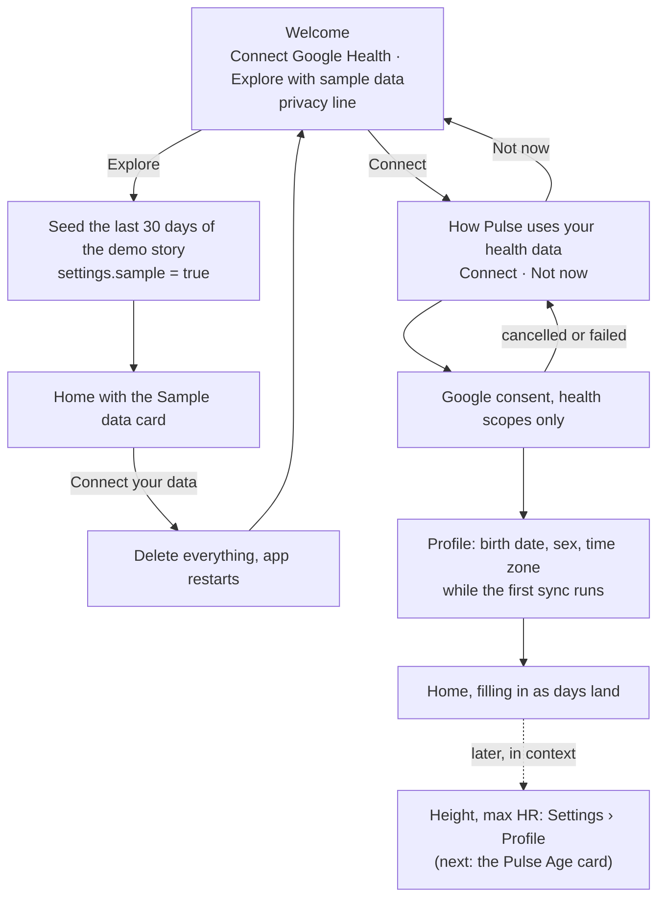

# Onboarding

First run should show Pulse working before it asks for anything. The model is Baro's onboarding: a welcome screen with two
ways in, a plain explainer before Google's consent screen, and Home appearing while the first sync is still running.
Questions come up where their answer is used, not in a form up front.

## The flow

## What is built

| Step | Where | Notes |
|---|---|---|
| Welcome | `src/screens/onboarding/OnboardingScreen.tsx` `Welcome` | The brand mark, two buttons and the privacy line. Sample mode shows the seed's progress in place of the buttons. |
| Sample data | `loadDemoData(store, { days: 30 })` in `src/seed/load.ts` | Writes the demo story's last 30 days, so the scripted events keep their dates and today is still the story's last day. The demo saves its own profile, which opens the gate. |
| Sample flag | `settings.sample` (`src/data/repos/settings.ts`) | Set before the seed runs, so a seed that stops halfway still shows the card that offers a fresh start. |
| Sample data card | `src/screens/home/SampleBanner.tsx` | "Connect your data" runs Delete everything: sample rows never mix with Google's. |
| Explainer | `OnboardingScreen.tsx` `Explain` | One line per scope group in `src/google/oauth.ts` `SCOPES`, plus what Pulse writes. Android back returns to Welcome. |
| Profile | `OnboardingScreen.tsx` `Profile` | The same `ProfileForm` as before. It now follows the connect, so it can fill the wait of the first sync. |

The gate (`src/screens/onboarding/gate.ts`) is unchanged: the tabs open once a profile exists. Sample mode gets there
through the demo profile, and a real connect gets there through the profile step.

## Why the profile is not deferred further

Baro asks for a birth date only on its Age tab. Pulse cannot: the pipeline reads the profile before scoring anything
(`src/pipeline/index.ts`). Max HR is estimated from age and drives Strain, and sex sets the reference ranges. So the
profile is asked while the first sync runs. Waiting there costs the person no time, and the scores are ready when they
reach Home.

## Native sign-in

In Baro the consent never leaves the app. On Android, the account chooser and the "Select what Baro can access" screen
are Google Identity Services' native sheets (the Authorization API), not a browser tab. Pulse can do the same on
Android. It needs a native module, so the app needs a development build, not Expo Go. On iOS, Google's sign-in always
runs in an in-app browser sheet (`ASWebAuthenticationSession`). It stays inside the app, but it is web content.

`connectGoogle()` in `src/screens/settings/connect.ts` is still a stub. Until it is built, Connect shows "isn't available
in this build yet" and sample data is the only way in.

## Not built yet

- The native connect step and the first sync (see above). The step after Connect also needs Home to show the syncing
  state, like Baro's empty dials.
- A "Build your first Pulse Age" checklist on the Pulse Age card for height and the other optional inputs.
- The sample data card on screens other than Home.
