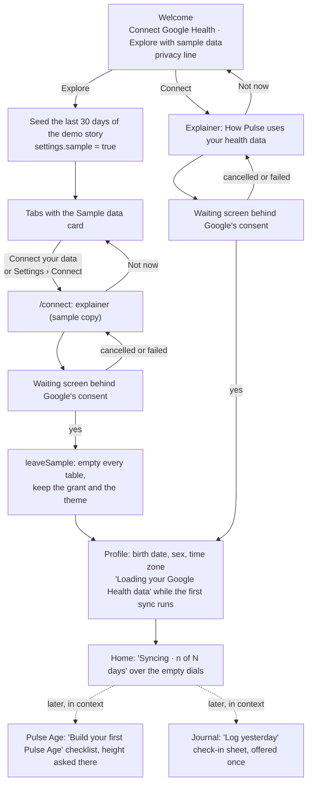

# Onboarding

First run should show Pulse working before it asks for anything. The model is Baro's onboarding: a welcome screen with two
ways in, a plain explainer before Google's consent screen, and Home appearing while the first sync is still running.
Questions come up where their answer is used, not in a form up front.

## The flow

## Where each piece lives

| Piece | Where | Notes |
|---|---|---|
| Steps and start | `src/screens/onboarding/OnboardingScreen.tsx`, `gate.ts` | Welcome, connect, profile. The gate opens onboarding on the profile step when Google is connected but no profile was saved (the app closed in between, or the sample was just left). |
| Frame | `src/screens/onboarding/Frame.tsx` | pulse's AuthShell: wordmark, one 400 px column, footer pinned to the bottom. |
| Explainer and waiting screen | `src/screens/onboarding/Connect.tsx` `ConnectFlow` | One line per scope group in `src/google/oauth.ts` `SCOPES`, plus what Pulse writes. While `connectGoogle()` runs, the "Google Health is asking for access" screen sits behind Google's sheet. Android back is "Not now". |
| Sample data | `loadDemoData(store, { days: 30 })` in `src/seed/load.ts` | The demo story's last 30 days, so its scripted events keep their dates and today is still its last day. The demo saves its own profile, which opens the gate. |
| Sample flag | `settings.sample` | Set before the seed runs, so a seed that stops halfway still shows the way out. `ShellData` passes it to the shells. |
| Sample data card | `src/ui/shells/SampleCard.tsx`, in `PageShell` | Top of every tab root. "Connect your data" opens `/connect`. |
| Leaving sample data | `app/connect.tsx`, `src/actions/sample.ts` | Google says yes first, so a cancelled consent keeps the sample. Then one transaction empties every table (`clearAllTables`, which follows `TABLE_OWNER`) except the new grant and the theme, and the profile step follows. Settings › Connect goes through `/connect` too while the sample is loaded. |
| First sync on Home | `HomeScreen.tsx` `FirstSync` | "Syncing · n of N days" over the dials while the first import runs (`connection: "importing"`). The dials show their own empty states. |
| Pulse Age checklist | `src/screens/health/FirstAge.tsx` | Replaces Pace of Aging until the first Pulse Age: recorded days out of 20, the Sleep, Strain and Fitness measures that are ready, and height (opens the profile sheet). |
| Log yesterday | `app/(tabs)/journal.tsx` `useOfferYesterday` | The first time the Journal opens on today with yesterday not checked in, the check-in sheet opens on yesterday. Once only (`journal.yesterdayOffered`). |

## Why the profile is not deferred further

Baro asks for a birth date only on its Age tab. Pulse cannot: the pipeline reads the profile before scoring anything
(`src/pipeline/index.ts`). Max HR is estimated from age and drives Strain, and sex sets the reference ranges. So the
profile is asked while the first sync runs. Waiting there costs the person no time, and the scores are ready when they
reach Home. Height is optional and waits for the Pulse Age checklist.

## Native sign-in (still a stub)

In Baro the consent never leaves the app. On Android, the account chooser and the "Select what Baro can access" screen
are Google Identity Services' native sheets (the Authorization API), not a browser tab. Pulse can do the same on
Android. It needs a native module, so the app needs a development build, not Expo Go. On iOS, Google's sign-in always
runs in an in-app browser sheet (`ASWebAuthenticationSession`). It stays inside the app, but it is web content.

`connectGoogle()` and `syncNow()` in `src/screens/settings/connect.ts` are still stubs. Until they are built, Connect
shows "isn't available in this build yet" on the explainer, sample data is the only way in, and the profile step, the
sample exit and Home's first-sync line cannot be reached on a phone.
