# Screenshots and phone mockups

How the images in `docs/screenshots/` were made: the app on the iOS simulator with sample data, captured screen by
screen, then framed as an iPhone 17 Pro. Pulse is Android only, so all of this happens in a throwaway copy of the
repo; nothing iOS lands in the repository.

```mermaid
flowchart LR
  Repo[pulse-mobile] -->|rsync, no android/ ios/ node_modules/ .git| Copy[pulse-mobile-builds/ios]
  Copy -->|app.json: platforms + ios.bundleIdentifier| Prebuild[expo prebuild --platform ios, pod install]
  Prebuild --> Run[expo run:ios --configuration Release]
  Run --> Tour[Tour: sample data, then each route; writes tour.txt]
  Tour -->|simctl io screenshot on each step| Shots[docs/screenshots/*.png]
  Shots -->|scripts/frame-screenshots.py| Framed[docs/screenshots/framed/*.png]
```



## 1. An iOS copy

```sh
cd ~/personal
mkdir -p pulse-mobile-builds/ios
rsync -a --delete --exclude /android --exclude /ios --exclude /node_modules --exclude /.git --exclude /.claude \
  pulse-mobile/ pulse-mobile-builds/ios/
cd pulse-mobile-builds/ios
ln -sfn ~/personal/pulse-mobile/node_modules node_modules
```

In the copy's `app.json`, set `expo.platforms` to `["android", "ios"]` and add
`expo.ios.bundleIdentifier` (`in.portlabs.pulse.shots`). Health Connect is safe on iOS: its module only throws when
called, and sample data never calls it.

## 2. Hide the sample-data marks (copy only)

- `src/screens/ShellData.tsx`: `sample: source === "demo"` becomes `sample: false` (drops the "Sample data" card).
- `src/screens/home/HeartRateTile.tsx`: drop the "The sample data has no readings yet." caption.

## 3. The tour (copy only)

There is no tap tool for the simulator here (no idb, computer use not set up) and `simctl openurl` asks "Open in
Pulse?" on every link, so the app drives itself. Add `src/tour.tsx`:

```tsx
import { useEffect } from "react";
import { router } from "expo-router";
import { File, Paths } from "expo-file-system";
import { exploreSample, useApp } from "@/state/app";

export const TOUR = ["/", "/sleep", "/recovery", "/strain", "/health", "/health/monitor", "/health/healthspan", "/health/stress", "/journal", "/trends", "/settings?s=goals"] as const;
const wait = (ms: number) => new Promise((r) => setTimeout(r, ms));

export function useSampleData() {
  const status = useApp((s) => s.status);
  useEffect(() => {
    if (status === "needs_profile") void exploreSample();
  }, [status]);
}

export function Tour({ onboarded }: { onboarded: boolean }) {
  useEffect(() => {
    if (!onboarded) return;
    let stop = false;
    void (async () => {
      const f = new File(Paths.document, "tour.txt");
      await wait(6000);
      for (let i = 0; i < TOUR.length && !stop; i++) {
        router.navigate(TOUR[i] as never);
        await wait(6000);
        f.write(String(i)); // the screen has settled: capture now
        await wait(2500);
      }
      f.write("done");
    })();
    return () => void (stop = true);
  }, [onboarded]);
  return null;
}
```

In the copy's `app/_layout.tsx`: call `useSampleData()` at the top of `RootLayout`, and render
`<Tour onboarded={onboarded} />` next to `<Screens onboarded={onboarded} />`.

## 4. Build, run and capture

```sh
cd ~/personal/pulse-mobile-builds/ios
CI=1 npx expo prebuild --platform ios --no-install && (cd ios && pod install)
CI=1 npx expo run:ios --configuration Release --device "iPhone 17 Pro" --no-bundler

xcrun simctl status_bar booted override --time 9:41 --batteryLevel 100 --batteryState charged --wifiBars 3 --cellularBars 4
SH=/tmp/shots; mkdir -p $SH
xcrun simctl terminate booted in.portlabs.pulse.shots 2>/dev/null
DATA=$(xcrun simctl get_app_container booted in.portlabs.pulse.shots data)
rm -f "$DATA/Documents/tour.txt"
xcrun simctl launch booted in.portlabs.pulse.shots
last=""
while :; do
  v=$(cat "$DATA/Documents/tour.txt" 2>/dev/null)
  if [ -n "$v" ] && [ "$v" != "$last" ]; then
    last=$v; [ "$v" = done ] && break
    xcrun simctl io booted screenshot "$SH/step-$v.png"
  fi
  sleep 0.5
done
```

A screen the tour does not reach (the coach's new chat, say): open it by hand in the simulator, then
`xcrun simctl io booted screenshot coach.png`. Keep the attractive ones only: no "Out of range" warnings, no empty
tiles, no settings forms. Copy the keepers into `docs/screenshots/` as `NN-name.png`.

Don't run a release APK build (`eas build --local`) while Xcode builds: Gradle runs out of Metaspace.

## 5. Frame them

```sh
python3 scripts/frame-screenshots.py docs/screenshots docs/screenshots/framed
```

Pillow draws the frame around each 1206 × 2622 capture: a 150 px screen radius, a 34 px black bezel, a 14 px titanium
edge, side buttons (action and volume on the left, power and camera control on the right), a blurred shadow and a dark
vertical gradient behind. The simulator's own status bar and Dynamic Island are part of the capture, so the frame needs
no notch of its own.
